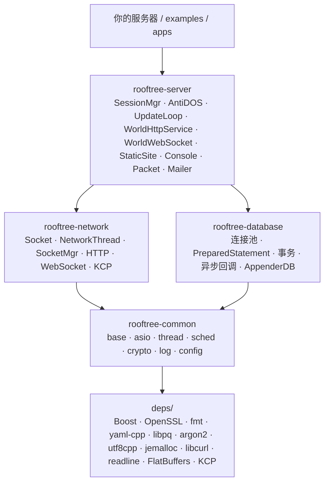
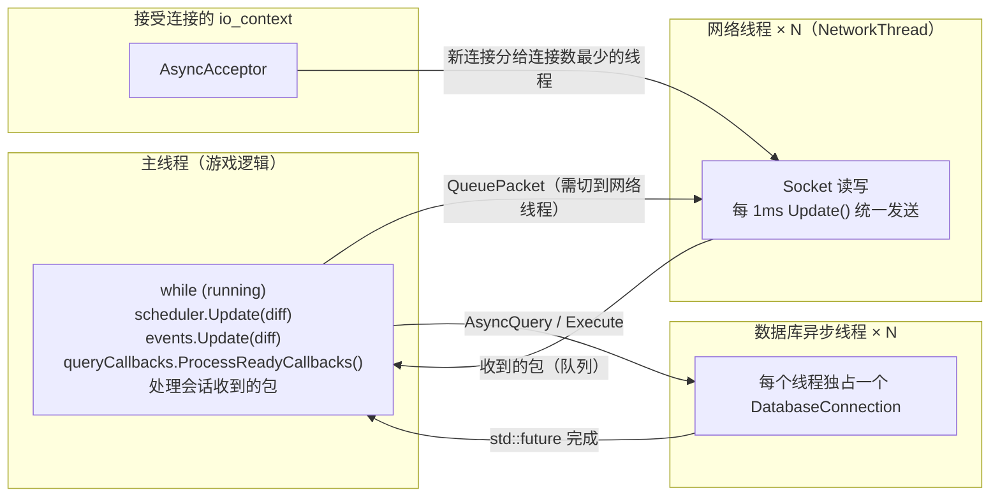

# 00 · 总览与学习路线

Rooftree 是一个**游戏服务器基础框架**：网络、数据库、调度、日志、配置、加密等通用底层设施，不包含任何游戏逻辑（地图、角色、战斗、脚本）。

这组文档按学习顺序逐个讲解这些组件。每篇都以源码为准，引用的位置写成 `文件:行号` 并链接到源码；代码改动后行号可能偏移，以函数名为准。

## 1. 分层

依赖是单向的：`rooftree-network` 和 `rooftree-database` 只依赖 `rooftree-common`，彼此独立；`rooftree-server` 在两者之上，提供会话和主循环。

## 2. 线程模型：逻辑单线程，IO / 数据库多线程

这是理解整个框架最重要的一张图。后面每篇文档都会说明"这个组件运行在哪个线程"。

几条贯穿全局的约定：

- **调度器不自带线程**：`TaskScheduler`、`EventMap` 都靠主循环每帧调用 `Update(diff)` 推进（[10](10-event-map.md)、[11](11-task-scheduler.md)）。
- **异步数据库回调在"轮询它的线程"上执行**：主线程调用 `ProcessReadyCallbacks()` 时才执行回调，所以游戏逻辑无需加锁（[12](12-async-callback-processor.md)、[24](24-query-callback-and-holder.md)）。
- **每个 Socket 只属于一个网络线程**：它的读写缓冲区不是线程安全的（[16](16-socket.md)）。
- **网络层用协程，不是多线程**：一条连接的读循环是一个协程，运行在它所属的网络线程上（[16](16-socket.md)），语义和回调一样，只是写法变成顺序的。主线程上的协程见 [29](29-server-core.md)。
- **KCP 不在上图的网络线程里**：一个 `Kcp::Server` 有自己的一条线程，所有连接都在上面收发和回调，`Send` 可以在任意线程调用（[33](33-kcp.md)）。
- **日志默认同步、每行立即 flush**；把 io_context 交给 `sLog->Initialize()` 才变成异步（[08](08-log.md)）。

## 3. 学习路线与文档索引

| 级别 | 文档 | 内容 | 精读量 |
|---|---|---|---|
| 0 | — | 前置知识：C++20（chrono、智能指针、移动语义、模板/CRTP/concepts）、Boost.Asio 基础 | — |
| 1 基础工具 | [01-define-errors](01-define-errors.md) | 整数类型、`ASSERT` 和 `ABORT` | 90 行 |
| | [02-time](02-time.md) | `Milliseconds`、`TimePoint`、`getMSTime` 和回绕 | 50 行 |
| | [03-string](03-string.md) | `StringFormat`（fmt）、`StringTo`、切分、十六进制、UTF-8、时长 | 350 行 |
| | [04-random](04-random.md) | `urand`、`frand`：每个线程一个生成器 | 70 行 |
| 2 字节缓冲 | [05-message-buffer](05-message-buffer.md) | 网络收发用的读写指针缓冲区 | 80 行 |
| 3 配置与日志 | [07-config](07-config.md) | YAML 配置、不可变快照、结构化读取、重载通知 | 420 行 |
| | [08-log](08-log.md) | Appender/Logger 日志：配置快照、YAML 结构化配置 | 900 行 |
| 4 调度器 | [10-event-map](10-event-map.md) | 事件 ID + 分组 + 阶段 | 170 行 |
| | [11-task-scheduler](11-task-scheduler.md) | 基于 lambda 的任务调度、补帧 | 200 行 |
| | [12-async-callback-processor](12-async-callback-processor.md) | 把异步结果交回主线程 | 60 行 |
| 5 并发 | [13-queues](13-queues.md) | `LockedQueue`（含给游戏分包的过滤取出）、`ProducerConsumerQueue`、`MPSCQueue`（推栈、整批取走） | 330 行 |
| | [14-thread-pool-and-asio](14-thread-pool-and-asio.md) | `ThreadPool`、`IoContext`、`Strand`、`DeadlineTimer` | 130 行 |
| 6 网络 | [15-async-acceptor](15-async-acceptor.md) | 接受连接 | 140 行 |
| | [16-socket](16-socket.md) | **核心**：读写、生命周期、关闭 | 490 行 |
| | [17-connection-start](17-connection-start.md) | 连接的开始：`Start()`、TLS 握手协程 | 90 行 |
| | [18-network-thread-and-socket-mgr](18-network-thread-and-socket-mgr.md) | 网络线程与连接分配 | 330 行 |
| | [19-http](19-http.md) | 基于 Beast 的 HTTP 服务与会话 | 1.2k 行 |
| | [27-websocket](27-websocket.md) | 浏览器长连接，握手、帧、跨线程发送 | 600 行 |
| | [33-kcp](33-kcp.md) | UDP 上的游戏连接：KCP 可靠消息 + 不可靠消息，AES-GCM 数据报、握手、换地址 | 1.4k 行 |
| | [28-http-routing](28-http-routing.md) | 路由树、路径参数、查询/表单/Cookie/multipart | 700 行 |
| 9 服务端核心 | [29-server-core](29-server-core.md) | 会话与主循环、每帧上限、AntiDOS、HTTP/WebSocket 接入、邮件 | 2.0k 行 |
| | [30-static-files-and-tls](30-static-files-and-tls.md) | 不用 nginx 直接对外：内存里的静态站点、TLS | 600 行 |
| | [31-console](31-console.md) | 控制台：命令表、终端线程、unix socket 上的远程控制台，命令在主线程的会话里执行 | 1.0k 行 |
| | [32-packets](32-packets.md) | opcode + FlatBuffers 的二进制包，校验、入口处的 JSON 转换、博客的操作表（读者和后台） | 1.5k 行 |
| 7 数据库 | [20-connection-and-statements](20-connection-and-statements.md) | PostgreSQL 连接、预处理语句、断线重连、和 MySQL 的差异 | 500 行 |
| | [21-query-result-and-field](21-query-result-and-field.md) | 结果集与字段读取 | 200 行 |
| | [22-database-worker-pool](22-database-worker-pool.md) | **核心**：连接池、同步/异步 | 500 行 |
| | [23-transaction](23-transaction.md) | 事务与死锁重试 | 100 行 |
| | [24-query-callback-and-holder](24-query-callback-and-holder.md) | 链式回调、批量查询 | 150 行 |
| | [25-appender-db](25-appender-db.md) | 日志写入数据库 | 90 行 |
| 8 加密 | [26-crypto](26-crypto.md) | SHA-1/SHA-256、随机字节、Argon2、TOTP | 200 行 |
| 附录 | [34-layout-and-build](34-layout-and-build.md) | 目录结构、依赖、构建、测试和性能测试、CMake 选项 | — |
| | [35-examples-and-apps](35-examples-and-apps.md) | 示例程序、arena 小游戏、博客 | — |

## 4. 每篇文档的结构

1. **是什么**：在服务器中扮演什么角色
2. **核心类与接口**
3. **关键实现**：带源码位置
4. **线程与安全**：运行在哪个线程、能否跨线程使用
5. **设计取舍**（如有）
6. **常见的坑**
7. **测试与示例**：可以直接运行、修改的代码
8. **思考题与练习**

## 5. 学习建议

- **先读 `.h` 再读 `.cpp`**：先弄清接口，再看实现。
- **测试就是说明书**：`tests/` 下每个用例都能直接运行和修改（`build/bin/tests "<用例名>"`）。
- **每学完一级，回到第 2 节的线程图**，把学到的类放到对应的线程里。

## 6. 容易踩的坑

1. **Socket 不支持半关闭**：读到 EOF 就立即 `CloseSocket()`，写队列里还没发出去的数据会被丢弃。`printf hi | nc host 7000` 这种"发完就 shutdown(SHUT_WR)"的客户端收不到回显，需要保持连接的客户端（游戏客户端正是如此）。
2. **写操作不是立即发出的**：`QueuePacket()` 只是入队，由 `NetworkThread` 每 1ms 调用一次 `Socket::Update()` 统一 flush（非 IOCP 平台）。这是为了合并小包。
3. **TaskScheduler 会补帧**：一次 `Update(350ms)` 会让周期 100ms 的任务执行 3 次，因为 `Repeat()` 是相对于任务自己的到期时间重新调度的（见 `tests/test_Framework.cpp`）。
4. **调度器都不自带线程**：TaskScheduler / EventMap / QueryCallbackProcessor 都依赖外部主循环调用 `Update(diff)` 或 `ProcessReadyCallbacks()`，这是"逻辑单线程 + IO/DB 多线程"模型的核心。
5. **数据库的预处理语句在 `PrepareStatements()` 时向服务器预编译**，所以表必须已经存在，写错的语句在启动时就会失败。
6. **`StopNetwork()` 与 acceptor 所在 io_context 的先后顺序**：如果 `Close()` 不等，就必须先停 io_context 再调用 `StopNetwork()`，否则被取消的 `async_accept` 回调会访问已经销毁的 `AsyncAcceptor`；即使按这个顺序，io_context 析构时仍会销毁一个持有已不存在网络线程 socket 的操作（ASan 发现）。Rooftree 的 `AsyncAcceptor::Close()` 会等这个操作完成，两种顺序现在都安全，见 [15 · 设计取舍](15-async-acceptor.md#5-设计取舍)。
7. **日志重载和多线程写文件是安全的**（[08](08-log.md)）：运行中 `LoadFromConfig()` 时其他线程照常写日志，同步模式下多个线程写同一个文件，行不会交错。每行立即 `fflush`（崩溃不丢日志）；重载时文件 appender 按配置重新打开（`w` 模式会清空文件）；异步模式下重载前已排队、重载后才执行的消息会被丢弃。
