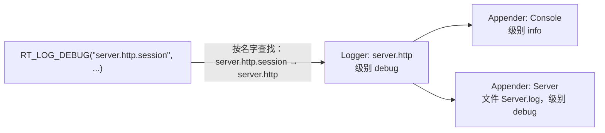

# 08 · 日志：Log、Logger、Appender

## 1. 是什么

日志模块的设计目标是：**稳定可靠，便于排查问题**。

- 每一行写出后立刻 `fflush`，进程崩溃时不会丢失最后几行日志；
- 可以按模块单独调整日志级别，例如只把网络模块调成 `debug`；
- 可以把不同模块的日志写到不同的文件、控制台，甚至数据库。

## 2. 核心概念：两层结构



| 概念 | 回答的问题 | 配置写法 |
|---|---|---|
| **Logger** | **记录什么**：某个模块的日志级别，以及写到哪些 appender | `Logger.<名字>`：`Level`、`Appenders` |
| **Appender** | **写到哪里**：控制台、文件、数据库，以及这个出口自己的级别和格式 | `Appender.<名字>`：`Type`、`Level`、`Flags` 和各类型的参数 |

一条日志要被输出，必须**同时**通过 logger 的级别和 appender 的级别。比如上图中，一条 debug 日志会进 `Server.log`，但不会出现在控制台上。

### 配置格式

```yaml
LogsDir: "logs"                                   # 文件 appender 的目录

Appender:
  Console:
    Type: 1                                       # 控制台
    Level: 3                                      # info
    Flags: 7                                      # 时间戳 + 级别 + logger 名
    Colors: [9, 1, 8, 2, 6, 7]                    # 依次对应 fatal error warn info debug trace
  Server:
    Type: 2                                       # 文件
    Level: 2                                      # debug
    Flags: 7
    File: Server.log
    Mode: w                                       # w=覆盖，a=追加（默认）
  GM:
    Type: 2
    Level: 3
    Flags: 1
    File: GM.log
    MaxSize: 536870912                            # 超过 512MB 换新文件

Logger:
  root:                                           # 所有日志最终都会回退到 root
    Level: 3
    Appenders: [Console, Server]
  server.http:                                    # 带点的名字写成一个键，不要拆成嵌套映射
    Level: 2
    Appenders: [Console, Server]
  commands.gm:
    Level: 3
    Appenders: [Console, GM]
```

| 字段 | 取值 |
|---|---|
| `Level` | 0 关闭、1 trace、2 debug、3 info、4 warn、5 error、6 fatal |
| `Type` | 1 控制台、2 文件、3 数据库（需要注册 [AppenderDB](25-appender-db.md)） |
| `Flags`（可相加） | 1 前缀时间戳、2 前缀级别、4 前缀 logger 名、8 文件名加时间戳、16 覆盖前先备份旧文件 |
| `Colors`（控制台） | 6 个颜色：0 black、1 red、2 green、3 brown、4 blue、5 magenta、6 cyan、7 grey、8 yellow、9 lred、10 lgreen、11 lblue、12 lmagenta、13 lcyan、14 white |
| `File` / `Mode` / `MaxSize`（文件） | 文件名、`a` 追加或 `w` 覆盖、单个文件的最大字节数 |
| `Args`（其他类型） | 自定义 appender 的参数列表，按顺序传给它 |

写错时由解析代码在 stderr 报错。每个字段都能单独用环境变量覆盖（加载配置时读取），例如 `ROOFTREE_APPENDER_CONSOLE_LEVEL=2`。

#### 一行的写法

也可以把所有参数用逗号拼成一个字符串，INI 式的配置文件只能这样写。这种写法可以和结构化写法混用：

```yaml
Appender:
  Console: "1,3,7,9 1 8 2 6 7"                    # 类型,级别,标志,颜色
  Server:  "2,2,7,Server.log,w"                   # 类型,级别,标志,文件名,模式
Logger:
  root: "3,Console Server"                        # 级别,Appender列表
```

`Log` 只解析这种字符串。结构化写法由 [LogConfig.cpp](../src/common/log/LogConfig.cpp) 在读取时拼回同样的字符串，再交给同一段解析代码，所以两种写法的行为完全一致。

完整说明见 [examples/rooftree.yaml.dist](../examples/rooftree.yaml.dist) 的 `LOGGING SYSTEM SETTINGS` 一节。

## 3. 核心接口

| 接口 | 作用 | 位置 |
|---|---|---|
| `RT_LOG_TRACE/DEBUG/INFO/WARN/ERROR/FATAL(logger, format, ...)` | 写一行，最常用 | [Log.h](../src/common/log/Log.h) |
| `sLog->LoadFromConfig()` | 按配置（重新）建立所有 appender 和 logger | [Log.cpp](../src/common/log/Log.cpp) |
| `sLog->Initialize(ioContext)` | 之后的行都经过这个 io_context 写出，然后加载配置 | 同上 |
| `sLog->SetSynchronous()` | 回到在写日志的线程上直接写（退出前，io_context 停了以后） | 同上 |
| `sLog->ShouldLog(logger, level)` | 这个级别会不会输出 | 同上 |
| `sLog->SetLogLevel(name, level, isLogger)` | 运行中改一个 logger 或 appender 的级别 | 同上 |
| `sLog->RegisterAppender<T>()` | 注册自定义 appender 类型（[25](25-appender-db.md) 的数据库 appender） | [Appender.h](../src/common/log/Appender.h) |

自定义 appender 继承 `Appender`，有一个静态成员 `static constexpr AppenderType Type`，构造函数是 `(id, name, level, flags, args)`，实现 `GetType()` 和 `Write(message, prefix)`。`args` 是配置行按逗号拆开的全部值，自己的值从第 4 个开始；用不了时抛 `InvalidAppenderArgs`，这个 appender 就不会被创建。

## 4. 关键实现

### 4.1 一次 `RT_LOG_DEBUG` 经历了什么

宏展开为：

```cpp
if (Logger const* logger = sLog->GetEnabledLogger("server.http.session", LOG_LEVEL_DEBUG))
    sLog->OutMessageTo(logger, "server.http.session", LOG_LEVEL_DEBUG, format, args...);
```

1. **快速判断**：debug 比所有 logger 中最低的级别 `_lowest` 还低时直接返回，**参数都不会被格式化**。所以代码里可以放心写大量 `RT_LOG_DEBUG`：关闭时只有一次原子读和一次比较。
2. **查找 logger**（`FindLogger`）：先查线程本地缓存；没有时在当前配置里按 `server.http.session → server.http → server → root` 逐级找，结果放进缓存。不加锁。
3. **检查 logger 的级别**，不够就返回。
4. **格式化**：用 [03 · StringFormat](03-string.md) 生成文本，构造 `LogMessage`（级别、logger 名、文本、时间）。
5. **写出**：同步模式下当前线程立即交给 logger 的每个 appender；异步模式下 `post` 到 strand 上，由运行 io_context 的线程按顺序写出。
6. **每个 appender**（`Appender::Append`）：检查自己的级别，按标志拼出前缀（`2026-11-07_19:31:48 INFO [server.http] `），加锁后调用 `Write()`。

### 4.2 配置的快照

[Log.h](../src/common/log/Log.h) 里的 `Setup` 是某一时刻的全部配置：appender 列表和按名字的 logger 表。它**发布后就不再修改**：

- `LoadFromConfig()`、`CreateLoggerFromConfigLine()` 等修改配置的操作在一把锁下另建一个 `Setup`，再用原子指针 `_current` 换上去；
- 读的线程不加锁，只读 `_current`；
- 被换下来的 appender 调用 `Retire()`：之后什么都不写，并关闭文件。但它和旧的 `Setup`、旧的 logger 都**不释放**，因为别的线程这时可能正拿着它们的指针在写，异步队列里也可能还有指向旧 logger 的消息。重载是手动触发的少数操作，留下的只是几个小对象。
- 先换上新的、再停用旧的，所以重载的那一刻还在用旧 logger 的线程不会丢行。

线程本地缓存靠一个代数计数器 `_generation` 失效：每次发布后加一，读的线程看到代数变了就清空缓存。顺序很重要：读的线程**先读代数、再读 `_current`**，发布的一方**先换 `_current`、再加代数**。这样缓存里存的结果，最多是来自比它所记代数更新的配置，不会把旧配置的结果记在新的代数下。

### 4.3 文件 appender

[AppenderFile.cpp](../src/common/log/AppenderFile.cpp)：

- 每行拼好后**一次 `fwrite`** 写出并 `fflush`：崩溃时不丢日志，多个线程的行也不会交错；
- 写这一行会超过 `MaxSize` 时，把旧文件改名为"原名.时间"，再从头写一个新文件；
- 标志 8 在文件名里加上进程启动的时间，标志 16 在 `w` 模式打开前先把旧文件改名保留。

### 4.4 控制台 appender

error 和 fatal 输出到 stderr，其他级别输出到 stdout；可以按级别设置颜色。每行之后 `fflush`：stdout 不是终端时是全缓冲的（systemd 下接的是 journald，Docker 下是管道），不 flush 的话日志要攒够几 KB 才出来，排在 stderr 的错误后面，`FreezeDetector` 让进程退出时缓冲里的还会丢掉。

### 4.5 异步模式

把 io_context 传给 `sLog->Initialize()` 后：

- **写日志的线程**只负责格式化，然后 `post` 到 strand 上；
- **运行这个 io_context 的线程**按顺序写出，strand 保证写入串行、有序。

代价是：进程崩溃时，还在队列里的行会丢失。

## 5. 线程与安全

- `RT_LOG_*` 可以在任何线程调用。
- `LoadFromConfig()`、`SetLogLevel()`、`Create*FromConfigLine()` 可以在其他线程正在写日志时调用。
- `Initialize()` / `SetSynchronous()` 只在启动和退出时调用。

## 6. 设计取舍

| 没有采用的做法 | Rooftree | 原因 |
|---|---|---|
| `LoadFromConfig()` 销毁所有 logger 和 appender，而其他线程手里还有它们的指针 | 新配置是一份快照，旧的停用但不释放 | 重载的同时有线程写日志时，那种写法实测 10 次崩溃 5 次 |
| 文件 appender 分三次 `fwrite` 写前缀、正文、换行，没有加锁 | 每个 appender 一把写锁，每行一次 `fwrite` | 不这样做的话，8 个线程同时写时，超过 8 成的行被拆散 |
| 查 logger 时每次都加读锁、逐级回退 | 线程本地缓存，不加锁 | 按名字查找快约 3 倍 |
| `Appender.*` / `Logger.*` 只能写成 `"1,3,7,..."` | 也可以写成 YAML 映射，`LogConfig` 转回同样的行 | 见 2 节 |
| 文件名里的 `%s` 是动态文件名（按玩家分文件的 `OutCharDump`），还有 `OutCommand` | 没有 | 只有角色数据导出和 GM 命令日志用到 |
| `SmartEnum` 生成的枚举名表、`LogOperation` | 一个 `LogLevelName()` 函数，一个 lambda | 用不着代码生成 |
| 级别和 appender 的读写是普通变量 | 原子变量 | 运行中会被 `SetLogLevel` 修改 |

## 7. 常见的坑

- **没有 `Logger.root` 时**，会打印 "no Logger.root"，然后只建一个 error 级别的 root 和一个 info 级别的 `server`，都输出到控制台。结果大部分日志都看不到。
- **重载配置不会自动重载日志**：`sConfigMgr->Reload()` 只换掉配置快照，日志还在用旧的 appender 和 logger，要再调用一次 `sLog->LoadFromConfig()`。也可以用 `sConfigMgr->OnLoaded()` 订阅，让每次加载后自动重载日志（见 [07](07-config.md) 第 4 节）。
- **logger 和 appender 两层都要允许**：把 logger 设成 debug 但 appender 是 info，debug 日志照样不会出现。
- **带点的 logger 名字不能写成嵌套映射**：`Logger: {server: {http: ...}}` 会被当成名为 `server` 的结构化 logger，并报 `Unknown field 'http'`。要写成 `server.http:`。
- **字段名写错只报错，不会阻止启动**：`Flag: 7`（少了 s）会在 stderr 打印 `Unknown field 'Flag'`，appender 仍然按其余字段创建，这个字段被忽略。
- **只开 `PrefixLogLevel` 时级别和正文之间没有空格**：级别只补齐到 5 个字符，`DEBUG` 正好 5 个字符，于是输出 `DEBUGmessage`。和 `PrefixLogFilterType` 一起用就没问题。
- **重载时文件 appender 会重新打开文件**：`w` 模式会清空文件。需要保留历史日志就用 `a` 模式。
- **时间戳只精确到秒**。
- **异步模式下崩溃会丢消息**，而断言信息不受影响，因为它直接写 stderr（见 [01](01-define-errors.md)）。

## 8. 测试与示例

[tests/test_Framework.cpp](../tests/test_Framework.cpp) 里的日志测试：

| 测试 | 验证内容 |
|---|---|
| Log resolves loggers hierarchically | 层级回退、快速判断阈值、运行中改级别 |
| Log can be reloaded while other threads log | 重载安全（ASan 下运行可检测 use-after-free） |
| File appender keeps lines whole with many writing threads | 8 个线程同时写，没有交错的行 |
| Async logging writes every message in order | strand 异步模式不丢消息、保持顺序 |
| Reloading reopens file appenders | `w` / `a` 模式在重载时的行为 |

## 9. 思考题与练习

1. 配置一个 `Network.log`，只记录 `network` 及其子 logger 的 debug 日志，控制台保持 info。运行 `echo_server` 验证。
2. 把 `Log.h` 里 `RT_LOG_MESSAGE_BODY` 宏展开，解释为什么 `RT_LOG_DEBUG("x", "{}", ExpensiveCall())` 在 debug 关闭时不会调用 `ExpensiveCall()`。
3. 为什么选择"保留旧对象"而不是用 `shared_ptr` 管理 logger？提示：考虑每次写日志时的开销，以及异步队列里的消息。
4. 把 `FindLogger` 里读代数和读 `_current` 的顺序调换，构造一个线程交错的例子，说明缓存会记住什么错误的结果。
