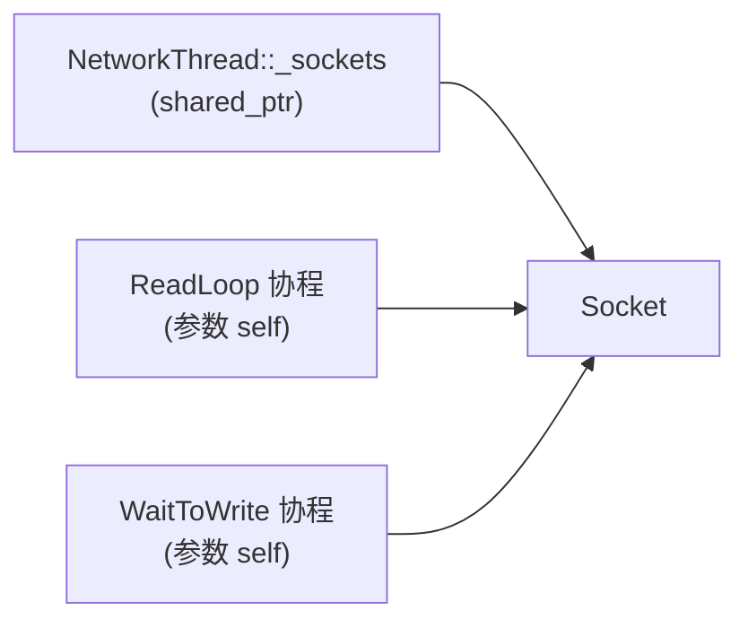

# 16 · Socket：连接的读写与生命周期

## 1. 是什么

`Rooftree::Net::Socket<Stream>` 代表**一个 TCP 连接**，是整个网络层最核心的类。HTTP 连接、WebSocket 连接、以后的游戏连接都继承自它。

它负责：

- 不断异步读取数据，读到后调用子类的 `ReadHandler()`；
- 维护一个写队列，由网络线程定期把队列里的数据发出去；
- 管理连接的打开、"写完再关"、关闭三种状态；
- 用 `shared_ptr` 保证对象在异步操作期间不会被提前销毁。

## 2. 核心接口

| 接口 | 作用 | 位置 |
|---|---|---|
| `Socket(IoContextTcpSocket&&)` | 用接受到的连接构造（服务端） | [Socket.h](../src/common/network/Socket.h) |
| `virtual void Start()` | 连接建立后由 `SocketMgr` 调用：子类在这里开始读（`StartReading()`），TLS 连接先 `AcceptTls`（[17](17-connection-start.md)） | [Socket.h](../src/common/network/Socket.h) |
| `virtual ReadHandler()` | **子类实现**：处理读缓冲区里的数据，返回 `KeepReading` 或 `Stop` | [Socket.h](../src/common/network/Socket.h) |
| `GetReadBuffer()` | 读缓冲区（[MessageBuffer](05-message-buffer.md)） | [Socket.h](../src/common/network/Socket.h) |
| `QueuePacket(MessageBuffer&&)` | 把数据放进写队列（**不是立即发送**） | [Socket.h](../src/common/network/Socket.h) |
| `virtual bool Update()` | 由网络线程每 1ms 调用，发送写队列里的数据；返回 `false` 表示该移除了 | [Socket.h](../src/common/network/Socket.h) |
| `CloseSocket()` | 立即关闭 | [Socket.h](../src/common/network/Socket.h) |
| `DelayedCloseSocket()` | 写队列发完后再关闭 | [Socket.h](../src/common/network/Socket.h) |
| `virtual void OnClose()` | 关闭时的回调 | [Socket.h](../src/common/network/Socket.h) |
| `GetRemoteIpAddress()` / `GetRemotePort()` | 对端地址 | [Socket.h](../src/common/network/Socket.h) |
| `SetDeadline(...)` / `ClearDeadline()` | Rooftree：到这个时间点还开着就关闭（3.6） | [Socket.h](../src/common/network/Socket.h) |
| `SetIdleTimeout(Milliseconds)` | Rooftree：这么久没读到任何数据就关闭（3.6） | [Socket.h](../src/common/network/Socket.h) |
| `SetMaxWriteQueueSize(bytes)` | Rooftree：写队列超过这么多字节就关闭（3.7） | [Socket.h](../src/common/network/Socket.h) |
| `SetConnectionTicket(ticket)` | Rooftree：`SocketMgr` 交给它的连接计数凭证，随 socket 一起销毁（[18](18-network-thread-and-socket-mgr.md)） | [Socket.h](../src/common/network/Socket.h) |

一个最小的子类（来自 [echo_server](../examples/echo_server.cpp)）：

```cpp
class EchoSocket final : public Socket<>
{
public:
    using Socket::Socket;

    void Start() override
    {
        StartReading();   // 开始读
    }

    SocketReadCallbackResult ReadHandler() override
    {
        MessageBuffer& packet = GetReadBuffer();
        MessageBuffer reply(packet.GetActiveSize());
        reply.Write(packet.GetReadPointer(), packet.GetActiveSize());
        packet.ReadCompleted(packet.GetActiveSize());
        QueuePacket(std::move(reply));
        return SocketReadCallbackResult::KeepReading;
    }
};
```

## 3. 关键实现

### 3.1 生命周期：谁持有 Socket



Socket 总是通过 `shared_ptr` 管理，有两类持有者：

- 网络线程的 socket 列表；
- 每个正在运行的协程：`ReadLoop` 和 `WaitToWrite` 都按值持有 `self`。

连接关闭后，`Update()` 返回 `false`，网络线程把它从列表里移除；最后一个协程结束，引用计数归零，析构函数关闭底层 socket。所以**没有任何地方手动 `delete` 一个 Socket**。

### 3.2 读：一个协程循环

`StartReading()` 启动一个协程（`ReadLoop`），它一直读到 `ReadHandler()` 说 `Stop` 或连接关闭：

```cpp
while (self->IsOpen())
{
    auto [error, bytes] = co_await Rooftree::Await<boost::system::error_code, std::size_t>([&](auto done)
    {
        buffer.Normalize();                 // 05 里讲的流程：整理，保证有空间
        buffer.EnsureFreeSpace();
        self->_stream.async_read_some(boost::asio::buffer(buffer.GetWritePointer(), buffer.GetRemainingSpace()), std::move(done));
    });
    if (error)                              // 对端关闭（EOF）或者出错
    {
        self->CloseSocket();
        co_return;
    }
    self->_readBuffer.WriteCompleted(bytes);
    if (self->ReadHandler() == SocketReadCallbackResult::Stop)
        co_return;
}
```

协程设施都在 [sched/Task.h](../src/common/sched/Task.h)，没有用 Boost.Asio 的 `awaitable`：

- `Rooftree::Detached` 是没有人等待的协程，在调用线程上立刻开始，结束时释放自己。
- `Rooftree::Await<结果类型...>(发起函数)` 把一个带回调的异步操作变成可以 `co_await` 的东西。协程在回调里恢复，所以运行在连接所属的网络线程上，和回调写法一样。如果操作永远不回调、随 io_context 一起销毁，协程也一起销毁，`self` 跟着释放。

`ReadHandler()` 抛出的异常只关闭这条连接并记一行 ERROR，不会一路抛出 `io_context::run()` 让整个进程退出。`ReadHandler()` 返回 `Stop` 时就不再继续读，比如 HTTP 解析出错要断开连接，或者一个请求要异步回答、先暂停读（[19](19-http.md)）；之后再调用 `StartReading()` 接着读。

### 3.3 写：先入队，统一发送

1. `QueuePacket()` 只是把数据放进写队列 `_writes`，**不做任何系统调用**；
2. 网络线程每 1ms 调用一次 `Update()`，`Update()` 调用 `WriteQueued()`；
3. `WriteQueued()` 对队头调用**非阻塞的同步** `write_some`：
   - 全部写完：弹出队头，继续下一个；
   - 只写了一部分，或者返回 `would_block`（发送缓冲区满了）：启动 `WaitToWrite` 协程，`async_wait(wait_write)` 等 socket 变得可写，然后再继续。等待期间 `Update()` 不再写。

为什么不在 `QueuePacket` 里直接发送？因为一个游戏帧里可能给同一个玩家发好几十个包，攒起来在一次 `Update` 里连续写出，能显著减少系统调用次数和小包数量。代价是每个包最多多延迟约 1ms。

### 3.4 三种打开状态

| 状态 | 含义 | 进入方式 |
|---|---|---|
| `Open` | 正常读写 | 构造时 |
| `Closing` | 不再接受新的关闭请求，写队列发完后自动关闭 | `DelayedCloseSocket()` |
| `Closed` | 已关闭，`Update()` 返回 `false` | `CloseSocket()` |

状态是一个原子变量。`CloseSocket()` 用 `exchange` 保证 `OnClose()` 只会被调用一次。

`DelayedCloseSocket()` 的典型用途是"发送一个错误提示，然后断开"。HTTP 在响应不需要 keep-alive 时就是这么做的（[19](19-http.md)）。

### 3.5 关闭时只 shutdown 发送方向

`CloseSocket()` 调用的是 `shutdown(shutdown_send)`，通知对端"我不会再发数据了"，真正释放文件描述符要等到析构。

### 3.6 超时：在 Update() 里比较时间

不设超时的话，socket 会一直等对端：一个连接上来什么都不发，或者每隔几秒发一个字节、永远发不完一个请求（slowloris），都会一直占着。游戏服前面没有 nginx 替它挡，所以 Rooftree 加了两种超时，默认都关闭：

- **截止时间**（`SetDeadline`）：到了这个时间点还开着就关闭，不管期间收到多少数据。用来限制"握手""请求头"这类必须在一定时间内完成的阶段，一个字节一个字节地慢慢发也没用。
- **空闲超时**（`SetIdleTimeout`）：这么久没读到任何数据就关闭，每次读到数据都重新计时。用来限制"连接还在、但对端已经不说话了"。

检查放在 `Update()` 里：网络线程本来就每 1ms 调用一次每个 socket 的 `Update()`，在这里比较一下时间就够了，不用给每个连接开一个 asio 定时器。读到数据时在读循环里记下时间（只在设了空闲超时时读时钟）。没有设任何超时的连接不读时钟：网络线程每 1ms 对每个连接都要检查一次，连接多了，读时钟本身就是开销。超时后调用 `CloseSocket()` 并返回 `false`，和对端断开时走同一条移除路径。正在关闭（Closing，等写队列发完）的 socket 也会检查：对端不读，写队列永远发不完，也得有个头。

具体在哪个阶段用哪种超时，由协议决定：HTTP 见 [19](19-http.md)，WebSocket 见 [27](27-websocket.md)。

### 3.7 写队列的上限

写队列是无界的：对端只连不读时，内核的发送缓冲区先满，之后 `QueuePacket()` 的数据就一直堆在内存里。服务器会主动推送的协议（WebSocket 的广播、游戏的状态同步）最容易遇到。

`_queuedBytes` 记着还没写出去的字节数：入队时加上，写出去多少减多少。设了 `SetMaxWriteQueueSize` 以后，超过上限就关闭连接，客户端都不读了，再给它发也没有意义。上限是按字节算的，一次很大的响应（HTTP 返回一张大图片）本身就可能超过它，所以只给推送型的连接设，HTTP 不设。

## 4. 线程与安全

**每个 Socket 只属于一个网络线程**：它的读回调、写回调、`Update()` 都在那个线程上执行。因此：

- 读缓冲区、写队列都**没有加锁**；
- **`QueuePacket()` 不是线程安全的**，只能在所属的网络线程上调用。

那么主线程处理完一个请求后，要怎么给客户端回包？做法是：

1. 主线程调用连接的发送函数（WebSocket 的 `SendText`），把包放进一个**无锁的 `MPSCQueue`**（[13](13-queues.md)）；
2. 网络线程在连接的 `Update()` 里，先把 MPSC 队列里的包取出来转进写队列，再调用基类的 `Update()` 发送（[27](27-websocket.md)）。

做协议层时，你也需要类似的机制。只有 `CloseSocket()` 和 `IsOpen()` 可以安全地在别的线程调用，因为状态是原子变量。

## 5. 设计取舍

`Socket.h` 每 1ms 在 `Update()` 里非阻塞地写。其他取舍：

- 读、等待可写都是协程（3.2），`ReadHandler` 的异常只关闭这个连接，不再让进程退出。
- 握手、开始读这些步骤在 `Start()` 里直接写，不用"连接初始化链"，TLS 握手是一个协程（[17](17-connection-start.md)）。
- 没有 `Connect`、`SetNoDelay`（`SocketMgr` 已经给每个连接打开 `TCP_NODELAY`），也没有 Windows 的 IOCP 分支。
- 超时（3.6）、写队列上限（3.7）、连接计数凭证默认都关闭。

## 6. 常见的坑

- **不支持半关闭**：读到 EOF 就立即关闭整个连接，写队列里还没发出去的数据会被丢弃。像 `printf hi | nc host 7000` 这种"发完就关闭发送方向"的客户端收不到回显。游戏客户端会保持连接，所以没有问题。（[00 · 容易踩的坑](00-overview.md#6-容易踩的坑) 第 1 条）
- **写操作最多延迟约 1ms**：对延迟极其敏感的场景要知道这一点。（注意事项第 2 条）
- **构造时会读取 `remote_endpoint()`**：如果对端在 accept 之后立即断开，构造函数会抛异常。`SocketMgr::OnSocketOpen` 捕获了它。
- **在别的线程调用 `QueuePacket()`**：数据竞争，可能导致崩溃或数据错乱，而且很难复现。用 TSan 构建可以检测到。

## 7. 测试与示例

- [tests/test_Network.cpp](../tests/test_Network.cpp) 的 "SocketMgr echoes data over loopback"：同一连接多条消息、1MB 二进制数据（测试了写队列的分段发送和 `async_wait`）、16 个并发客户端、服务端感知到客户端断开。
- [examples/echo_server.cpp](../examples/echo_server.cpp)。

## 8. 思考题与练习

1. 在 `echo_server` 里实现第 [05](05-message-buffer.md) 篇的拆包：协议是"2 字节长度 + 内容"，只有收到完整的包才回显。用一个 Python 脚本把一个包拆成好几次、每次只发 1 个字节来测试。
2. 设计一个线程安全的 `SendPacket()`：主线程调用它，数据最终由网络线程发出。（提示：MPSCQueue + 在 `Update()` 里转移。）
3. 用 `DelayedCloseSocket()` 实现：客户端发来 `quit`，服务器回复 `bye` 后断开。验证客户端能收到 `bye`。
4. 解释为什么 1MB 的回显测试必须在客户端用一个单独的线程写数据，否则可能死锁。
