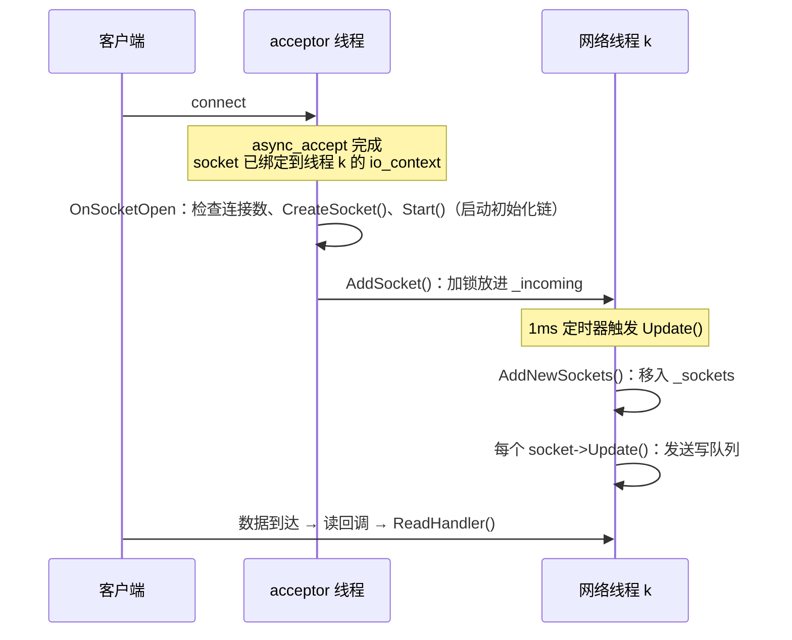

# 18 · NetworkThread 与 SocketMgr：网络线程和连接管理

## 1. 是什么

- **`NetworkThread`**：一个网络线程。它拥有自己的 io_context 和一批 socket，每 1ms 调用一次所有 socket 的 `Update()`。
- **`SocketMgr`**：一个网络服务。它启动 N 个网络线程和一个 acceptor，把每个新连接分给当前连接数最少的线程。

每种服务器的连接管理都是 `SocketMgr` 的子类，比如 [echo_server](../examples/echo_server.cpp) 和 HTTP 的 `HttpService`（[19](19-http.md)）也是。

## 2. 核心接口

### SocketMgr\<Traits\>

| 接口 | 作用 | 位置 |
|---|---|---|
| `StartNetwork(ioContext, bindIp, port, threadCount)` | 创建 acceptor、启动网络线程、开始接受连接 | [SocketMgr.h](../src/common/network/SocketMgr.h) |
| `StopNetwork()` | 关闭 acceptor，停止并等待所有网络线程 | [SocketMgr.h](../src/common/network/SocketMgr.h) |
| `virtual OnSocketOpen(socket)` | 新连接到来：检查连接数、构造 Socket、调用 `Start()`、交给网络线程 | [SocketMgr.h](../src/common/network/SocketMgr.h) |
| `SetMaxConnectionsPerAddress(max, exempt)` | Rooftree：每个客户端地址同时最多开几个连接（3.5），在 `StartNetwork` 之前调用 | [SocketMgr.h](../src/common/network/SocketMgr.h) |
| `SetAddressBlocklist(blocklist)` | Rooftree：这些地址的连接接受后马上关闭（3.5），在 `StartNetwork` 之前调用 | [SocketMgr.h](../src/common/network/SocketMgr.h) |
| `virtual CreateSocket(socket)` | Rooftree：构造 Socket。socket 需要额外参数（所属的服务、TLS context）时覆盖它 | [SocketMgr.h](../src/common/network/SocketMgr.h) |
| `SelectThreadWithMinConnections()` | 选出连接数最少的线程 | [SocketMgr.h](../src/common/network/SocketMgr.h) |
| `virtual CreateThreads()` | 创建线程数组；子类可以覆盖它，给每个线程注入额外信息 | [SocketMgr.h](../src/common/network/SocketMgr.h) |

`Traits` 用来告诉 `SocketMgr` 三个类型：

```cpp
struct EchoServerTraits
{
    using Self = EchoServer;               // 最终的子类（CRTP）
    using SocketType = EchoSocket;         // 每个连接的类型
    using ThreadType = EchoNetworkThread;  // 网络线程的类型
};
class EchoServer final : public SocketMgr<EchoServerTraits> { };
```

### NetworkThread\<SocketType, DerivedThread\>

| 接口 | 作用 | 位置 |
|---|---|---|
| `Start()` / `Stop()` / `Wait()` | 启动线程 / 通知停止 / 等待结束 | [NetworkThread.h](../src/common/network/NetworkThread.h) 起 |
| `AddSocket(sock)` | 把一个 socket 交给这个线程（任意线程都可以调用） | [NetworkThread.h](../src/common/network/NetworkThread.h) |
| `GetConnectionCount()` | 当前连接数 | [NetworkThread.h](../src/common/network/NetworkThread.h) |
| `virtual SocketAdded` / `SocketRemoved` | 子类可以覆盖的钩子 | [NetworkThread.h](../src/common/network/NetworkThread.h) |

## 3. 关键实现

### 3.1 一个新连接的完整旅程



几个要点：

- socket 在 accept 时就已经绑定到目标线程的 io_context（[15](15-async-acceptor.md)）；`OnSocketOpen` 通过比较 executor 找到它属于哪个线程。
- `Start()` 在 **acceptor 线程**上被调用，但它发起的异步读，回调在**网络线程**上执行。
- `AddSocket` 只是加锁放进 `_incoming`，网络线程在下一次 `Update()` 时才把它们移到 `_sockets`。这样 `_sockets` 只被网络线程自己访问，遍历它时不用加锁。

### 3.2 每 1ms 一次的 Update

`UpdateLoop` 协程每 1ms 醒一次：

1. 重新设定 1ms 定时器。**先设定再更新**：更新本身的耗时不计入周期，连接很多时也还是每 1ms 一次。先更新再设定的话，连接越多延迟越高（改成协程时踩过这个坑，压测里 64 个客户端慢了 10%）；
2. 把 `_incoming` 里的新连接移进 `_sockets`（正在关闭的也一样，见第 5 节）；
3. 对每个 socket 调用 `Update()`（发送写队列）；返回 `false` 的 socket 从列表中移除，连接数减 1，并调用 `SocketRemoved` 钩子。

这个 `Update()` 就是 [16 · Socket](16-socket.md) 中"写操作统一发送"的驱动者。

**测延迟时要注意相位**：响应在下一次 `Update()` 才写出，一个收到响应就立刻发下一个请求的客户端，会和这个 1ms 的周期锁在同一个相位上，每次测到的几乎都是"刚好错过一次更新、再等一整个周期"。换了测试的顺序、前面多跑一个测试，同一个"新连接上的 GET"就能从 770 µs 变成 600 µs。所以 [bench_Network.cpp](../benchmarks/bench_Network.cpp) 里有一个随机相位的版本（每次请求前先随机等 0–1 ms），比较两个版本时看它：协程化前后它的差别在 2% 以内。之前看到的"新连接慢 200 µs"就是相位造成的，不是每个连接多花的时间。

### 3.3 负载均衡

`SelectThreadWithMinConnections()` 选出 `_connections` 最小的线程。计数在 `AddSocket` 时加 1、socket 被移除时减 1，是原子变量。这是一个简单但有效的策略：长连接场景下，各线程的连接数会大致均衡。

### 3.4 CRTP 和 Traits

`SocketMgr` 通过 `static_cast<Self*>(this)->OnSocketOpen(...)`调用子类的方法，`NetworkThread` 也通过 `static_cast<DerivedThread*>(this)` 调用 `SocketAdded`/`SocketRemoved`。这样子类可以"覆盖"行为，而基类在编译期就知道确切的类型。

`CreateThreads()` 可以给每个网络线程注入自己需要的东西，比如线程在移除 socket 时要通知的对象。这个钩子现在没有用到，留给需要它的协议。

### 3.5 按地址限制连接数（Rooftree）

接受连接时如果什么都不查，一个客户端开几千个连接、每个都不说话，文件描述符和内存就被占满了。超时（[16 · 3.6](16-socket.md#36-超时在-update-里比较时间)）能让它们最终被关闭，但在那之前它们一直占着。

`ConnectionLimiter`（[ConnectionLimiter.h](../src/common/network/ConnectionLimiter.h)）记着每个地址当前开着几个连接。`OnSocketOpen` 在构造 socket **之前**问它：

- 地址被封（`AddressBlocklist`，[SocketMgr.h](../src/common/network/SocketMgr.h)）或已经到上限：直接返回，局部变量里的 TCP socket 析构时关闭，什么都没分配。
- 没到上限：计数加 1，拿到一张凭证（一个带自定义删除器的 `shared_ptr<void>`），交给 socket 保管。socket 不管从哪条路径关闭，最后析构时凭证跟着销毁，计数减 1，不会漏减。

计数表放在 `shared_ptr` 里，凭证也持有它：socket 可能比接受它的 `SocketMgr` 活得久（还在等 worker 回调的请求），那时减计数也不会访问已销毁的对象。

`exempt` 里的地址不计数：反向代理或负载均衡后面是很多客户端，它们的连接都来自同一个地址。IPv4 客户端连到双栈监听时地址是 `::ffff:a.b.c.d`，计数前统一转成 IPv4。

`AddressBlocklist`（[AddressBlocklist.h](../src/common/network/AddressBlocklist.h)）是一张临时封禁的地址表，只放在内存里。主线程在一个地址刷得太多时往里加（[29 · 3.4](29-server-core.md#34-antidos) 的 `BlockAfter`），网络线程在接受连接和请求之前查它，所以被封的地址不用握手、不用解析、也不用回复。IPv6 按 /64 封，和会话的 key 一样。

### 3.6 新连接默认 TCP_NODELAY（Rooftree）

`OnSocketOpen` 给每个接受的连接打开 `TCP_NODELAY`。一个响应分几段写出时（TLS 按记录写），Nagle 算法会扣住最后一段，等客户端确认前一段，而客户端的确认是延迟发送的，一等就是 40 ms。开启后 HTTPS 页面的 p99 从 42 ms 降到 1.1 ms。

## 4. 线程与安全

| 数据 | 谁访问 | 同步方式 |
|---|---|---|
| `_incoming` | acceptor 线程写入，网络线程读取 | `_incomingMutex` 互斥锁 |
| `_sockets` | 只有网络线程 | 不需要 |
| `_connections` | acceptor 线程读取，两边都会修改 | 原子变量 |
| `_stopped` | 任意线程设置 | 原子变量 |

## 5. 设计取舍

- 按地址限制连接数和封禁（3.5）、默认 `TCP_NODELAY`（3.6），以及把构造 socket 拆成可以覆盖的 `CreateSocket()`。以前 `WorldHttpService` 为了给 socket 传入服务自己，复制了一份 `OnSocketOpen`。
- `AddNewSockets()` 不能丢掉"不是 open 状态"的新 socket，因为其中也包括正在关闭、写队列还没发完的 socket：连接的第一次读取通常比 `AddNewSockets()` 更早完成，如果那次读取就调用了 `DelayedCloseSocket()`（HTTP 响应带 `Connection: close`、WebSocket 拒绝握手），响应就永远发不出去。所以新 socket 一律加入 `_sockets`，已经关闭的由 `Update()` 移除，只是晚一个周期（1ms）。回归测试见 test_Network.cpp 的 "HttpService routes requests over loopback"，丢掉的话 20 个连接里大部分收不到响应。

## 6. 常见的坑

### `StopNetwork()` 必须在 acceptor 的 io_context 停止之后调用

`StopNetwork()` 会关闭并**销毁** acceptor（[SocketMgr.h](../src/common/network/SocketMgr.h)、[SocketMgr.h](../src/common/network/SocketMgr.h)）。但被取消的那次 `async_accept` 的回调，仍然会在 acceptor 的 io_context 上执行，而回调访问了 acceptor 对象。如果这个 io_context 还在运行，就会访问已释放的内存。

本项目的示例都是这样做的，没有问题：

```cpp
ioContext.run();          // 收到 Ctrl+C 后 stop()，run() 返回
server.StopNetwork();     // 这时 io_context 已经停了，被取消的回调不会再执行
```

Rooftree 的网络测试最初的关闭顺序是反的，ASan 报出了 use-after-free，后来改成先停止 io_context（[test_Network.cpp](../tests/test_Network.cpp) 的 `StopNetworkGuard`）。见 README 注意事项第 6 条。

### 其他

- **`SocketMgr` 析构前必须调用 `StopNetwork()`**，否则析构函数里的 `ASSERT` 会让程序崩溃。
- **`StopNetwork()` 会等待所有网络线程结束**：如果某个 socket 的回调卡住了，这里也会卡住。

## 7. 测试与示例

- [tests/test_Network.cpp](../tests/test_Network.cpp)："SocketMgr echoes data over loopback"，以及 `ServerContext` 和 `StopNetworkGuard` 的写法；"SocketMgr limits the connections of an address"、"Socket closes connections that time out or don't read"。
- [examples/echo_server.cpp](../examples/echo_server.cpp)：一个完整的 `SocketMgr` 子类和 `main()`。

## 8. 思考题与练习

1. 给 `EchoNetworkThread` 覆盖 `SocketAdded`/`SocketRemoved`，打印"线程 X 现在有 N 个连接"。用 16 个客户端连接，观察连接是否被均匀分配。
2. 如果把网络线程的 `Update` 间隔从 1ms 改成 10ms，对回显延迟和 CPU 占用分别有什么影响？可以动手测一下。
3. 解释为什么 `_sockets` 不需要锁，而 `_incoming` 需要。
4. 自己写一个错误的关闭顺序（先 `StopNetwork()`，io_context 还在运行），在 ASan 构建下运行，观察报告。
