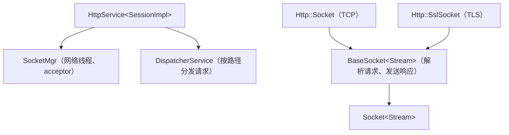

# 19 · HTTP：HttpService 与 BaseSocket

## 1. 是什么

一个建立在 [Socket](16-socket.md) 和 [SocketMgr](18-network-thread-and-socket-mgr.md) 之上的 HTTP 服务器，用 [Boost.Beast](https://www.boost.org/doc/libs/release/libs/beast/) 解析和序列化 HTTP 消息。

它是学习"如何在 Socket 之上实现一个协议"的绝佳范例：HTTP 层只覆盖了 `ReadHandler()`，`Socket` 的读写、关闭和线程模型完全复用。

## 2. 核心组成



| 类 | 作用 | 位置 |
|---|---|---|
| `HttpService<SessionImpl>` | 服务本身：同时继承 `SocketMgr` 和 `DispatcherService` | [HttpService.h](../src/common/network/http/HttpService.h) |
| `DispatcherService` | 注册处理函数，按 HTTP 方法 + 路径分发 | [HttpService.h](../src/common/network/http/HttpService.h) |
| `BaseSocket<Stream>` | 一个 HTTP 连接：解析请求、调用处理函数、发送响应 | [BaseHttpSocket.h](../src/common/network/http/BaseHttpSocket.h) |
| `RequestContext` | 一次请求：`request`、`response`、匹配到的处理函数、路径参数、流式响应体（3.6） | [HttpCommon.h](../src/common/network/http/HttpCommon.h) |
| `RequestHandlerResult` | `Handled`（发送响应）/ `Error`（发送响应后断开）/ `Async`（稍后再发送） | [HttpCommon.h](../src/common/network/http/HttpCommon.h) |

使用方式（来自 [examples/http_server.cpp](../examples/http_server.cpp)）：

```cpp
RegisterHandler(boost::beast::http::verb::get, "/hello",
    [](std::shared_ptr<HelloSession> session, Http::RequestContext& context)
    {
        context.response.result(boost::beast::http::status::ok);
        context.response.body() = "hello";
        return Http::RequestHandlerResult::Handled;
    });
```

## 3. 关键实现

### 3.1 一个请求的处理流程

1. **解析**：`BaseSocket::ReadHandler()`把读缓冲区里的数据喂给 Beast 的解析器。数据不完整时直接返回，等下次读取；完整时进入下一步。一次读取中有多个请求（管线化）也能逐个处理；Rooftree 改成一个请求返回 `Async` 后先暂停，等它的响应发出再处理下一个，见 [28 · 3.3](28-http-routing.md#33-一个连接同时只处理一个请求)。
2. **分发**：`DispatcherService::HandleRequest()`解码路径，在路由树里按方法和路径查找处理函数；找不到返回 404，路径对但方法不对返回 405（Rooftree 改动，见 [28](28-http-routing.md)）。同时设置 `Date`、`Server`、`keep-alive` 等响应头。
3. **响应**：处理函数返回 `Handled` 或 `Error` 时，`SendResponse()` 把响应序列化进一个 `MessageBuffer`，`QueuePacket()` 入队；之后 `ResponseQueued()` 在不是 keep-alive 时调用 `DelayedCloseSocket()`，**发完再断开**，否则开始等下一个请求。返回 `Async` 时，回答的一方之后在连接的网络线程上调用 `SendResponse()`。
4. 返回 `Error` 时，`ReadHandler` 关闭连接并停止读取。

### 3.2 方法

路由是一棵树，支持所有方法和 `{name}` 路径参数，见 [28 · HTTP 路由](28-http-routing.md)。HEAD 请求仍然复用 GET 的处理函数，序列化时只发送响应头。

### 3.3 没有 HTTP 会话

HTTP 层不给连接建会话（比如每个连接一个 UUID、通过 Cookie 找回）：示例和 arena 用不到，博客有自己的登录会话（Cookie → 账号，存在数据库里）。连接在日志里显示为 `[地址:端口]`。

### 3.4 日志与敏感信息

每个请求结束后，在 `server.http` logger 上记录一条 debug 日志；trace 级别时还会记录请求和响应的完整内容。注册处理函数时可以加上 `DoNotLogRequestContent` / `DoNotLogResponseContent` 标志，让包含密码等敏感信息的请求只记录 `<REDACTED>`。

### 3.5 超时（Rooftree）

`SetTimeouts(request, keepAlive)`在 `Start()` 之前调用，用的是 [16 · 3.6](16-socket.md#36-超时在-update-里比较时间) 的两种超时。一个连接按阶段切换：

| 阶段 | 超时 | 对应 nginx |
|---|---|---|
| 刚连上，或者下一个请求的第一个字节到了，直到请求头收完（TLS 握手也算在里面） | 截止时间 `request`：一个字节一个字节地发也不会延长 | `client_header_timeout` |
| 请求头已收完，正在收请求体 | 空闲超时 `request`：上传可以很慢，只要数据一直在来 | `client_body_timeout` |
| 处理函数正在执行（包括 `Async`） | 无：等数据库是服务器自己慢，不能算到客户端头上 | — |
| 响应已发出，等下一个请求 | 截止时间 `keepAlive` | `keepalive_timeout` |

切换在 `HandleReadRequests()` 和响应入队后的 `ResponseQueued()` 里（[BaseHttpSocket.h](../src/common/network/http/BaseHttpSocket.h)）。两个值都是 0 时不检查。

### 3.6 流式响应（Rooftree）

处理函数把 `context.responseStream`（[HttpCommon.h](../src/common/network/http/HttpCommon.h)，一个 `std::istream` 加长度）设好，响应体就边读边发，多大的文件都不用全放进内存。`rooftree-server` 里用 `WorldHttpRequest::RespondStream`（[WorldHttpService.h:106](../src/server/shared/http/WorldHttpService.h#L106)），博客的网盘下载和 zip 打包就是这样发的。

`QueueStreamed()` 只在写队列不到 1 MiB 时才读下一段（每段 256 KiB），之后由 `Update()` 接着调用，所以读得慢的客户端只占 1 MiB。发完之前连接不处理下一个请求，`Connection: close` 也要等最后一段。

- 读文件会阻塞网络线程，所以流应该是本地文件。
- 响应头发出去以后状态码就改不了了：流提前结束时记一条 error 日志并关闭连接，客户端看到的是一个不完整的响应体。
- HEAD 请求只发响应头（带长度），不读流。

## 4. 线程与安全

- 处理函数在连接所属的**网络线程**上执行。不同连接的请求可能在不同的线程上**并发**执行，处理函数访问共享数据时要自己加锁。
- 如果处理函数需要查数据库，不要在网络线程上做同步查询，而是返回 `Async`，等异步结果回来后再发送响应。

## 5. 设计取舍

一个请求的处理方式：Beast 解析和序列化、`Handled`/`Error`/`Async`、HEAD 只发头。其他取舍：

- 响应的 `Date` 头直接用 `gmtime_r` + `strftime` 生成，不需要时区模块。
- 路由、同一连接上请求按顺序处理、解析错误回 400/413：见 [28 · 设计取舍](28-http-routing.md#5-设计取舍)。
- 请求和 keep-alive 的超时（3.5），流式响应（3.6），WebSocket 升级（[27](27-websocket.md)）。
- 没有 HTTP 会话（3.3）。
- `HttpSocket`、`HttpSslSocket` 各自只剩几行：开始的方式见 [17](17-connection-start.md)。

## 6. 常见的坑

- **注册了 POST `/echo`，用 GET 访问同一个路径**：回 405 并带上 `Allow: POST`，不是 404。
- **处理函数里执行耗时操作**：会阻塞整个网络线程，这个线程上的所有其他连接都会卡住。

## 7. 测试与示例

- [tests/test_Network.cpp](../tests/test_Network.cpp) 的 "HttpService routes requests over loopback"：GET、POST、404、方法不匹配，以及在同一个 keep-alive 连接上发送多个请求。
- [tests/test_ServerNetwork.cpp](../tests/test_ServerNetwork.cpp) 的 "WorldHttpService streams a response body"：流式响应。
- [examples/http_server.cpp](../examples/http_server.cpp)：

  ```sh
  curl -i http://127.0.0.1:8080/hello
  curl -i -X POST -d ping http://127.0.0.1:8080/echo
  ```

## 8. 思考题与练习

1. 给 `http_server` 加一个 `GET /time` 接口，返回服务器当前时间。
2. 写一个 `POST /login` 接口，标记 `DoNotLogRequestContent`，把 `server.http` 调到 trace 级别，确认请求体没有出现在日志里。
3. 处理函数返回 `Async` 后，另一个线程完成了工作，要怎样才能安全地回答？看 `WorldHttpService` 是怎么把回答交回网络线程的（[29](29-server-core.md)）。
