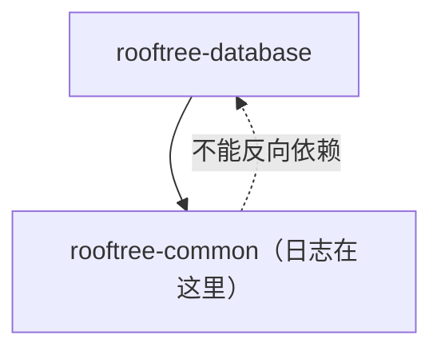

# 25 · AppenderDB：日志写入数据库

## 1. 是什么

一个把日志写进数据库表的 appender（日志输出端，见 [08](08-log.md)）。用途是把日志写进 `logs` 这样的表，方便在网页后台查询，或者跨多台服务器集中查看日志。

它也是"日志模块和数据库模块如何在不互相依赖的情况下协作"的一个很好的例子。

## 2. 分层问题：日志不能依赖数据库



日志模块在 `rooftree-common` 里，数据库模块在 `rooftree-database` 里，而且数据库依赖 common。如果日志模块直接创建 `AppenderDB`，就形成了循环依赖。

解决办法是**注册机制**（`Log::RegisterAppender<T>()`）：日志模块只认识"类型编号 → 创建函数"这张表，具体的类型由上层在启动时注册进来。配置里写 `Type = 3` 时，日志模块查表、调用对应的创建函数，完全不需要知道 `AppenderDB` 是什么。

## 3. 使用方式

它不写死某个数据库和插入语句，而是一个按连接类型参数化的模板（[AppenderDB.h](../src/database/AppenderDB.h)）：

```cpp
// 1. 在你的数据库里定义一条插入语句，参数是 time、realm、type、level、string：
//    时间、realm ID、logger 名、级别、内容
PrepareStatement(LOGIN_INS_LOG,
    "INSERT INTO logs (time, realm, type, level, string) VALUES (?, ?, ?, ?, ?)", CONNECTION_ASYNC);

// 2. 启动时，在加载日志配置之前注册：
AppenderDB<LoginDatabaseConnection>::SetDatabase(&LoginDatabase, LOGIN_INS_LOG);
sLog->RegisterAppender<AppenderDB<LoginDatabaseConnection>>();
sLog->LoadFromConfig();

// 3. 只有设置了 realm ID 之后才会写入：
sLog->SetRealmId(1);
```

配置：

```yaml
Appender:
  DB:                    # 等同于一行的 "3,2,0"
    Type: 3              # 数据库
    Level: 2             # debug

Logger:
  root:
    Level: 3
    Appenders: [Console, DB]
```

## 4. 关键实现

### 4.1 写入是异步的

`Write()` 用 `Database->Execute(stmt)` 提交插入（[AppenderDB.h](../src/database/AppenderDB.h)），这是一个**异步**操作，写日志的线程不会等待数据库。

### 4.2 防止无限循环

数据库模块自己也会写日志（`sql.sql`、`sql.driver` 等）。如果这些日志也写进数据库，每写一条日志都会产生新的数据库日志，就停不下来了。所以 `Write()` 直接忽略 logger 名字里包含 `sql` 的日志。

### 4.3 为什么要等 `SetRealmId`

一个数据库可能被多个服务器（realm）共用，`realm` 列用来区分日志来自哪个服务器。在 realm ID 确定之前写入的日志没有意义，所以 `AppenderDB` 默认是关闭的，`SetRealmId()` 被调用后才启用（realm ID 可以是 0）。

## 5. 线程与安全

- 和其他 appender 一样，写入受 appender 的写锁保护（[08](08-log.md)）。
- `SetDatabase` 设置的是**静态**成员，应该在启动阶段、`LoadFromConfig()` 之前调用一次。
- 连接池被 `Close()` 之前，要先切换到一个不包含数据库 appender 的日志配置，否则关闭过程中产生的日志可能会写进一个已经关闭的连接池。

## 6. 设计取舍

| | 没有采用的做法 | Rooftree |
|---|---|---|
| 目标数据库 | 写死 `LoginDatabase` | 模板参数 + `SetDatabase()` |
| 插入语句 | 写死 `LOGIN_INS_LOG` | 由使用方提供 |

## 7. 常见的坑

- **忘记调用 `SetRealmId()`**：什么都不会写入，也没有任何报错。
- **注册之前就加载了配置**：配置里的 `Type = 3` 找不到对应的创建函数，会打印 "Unknown type" 并跳过这个 appender。
- **级别设得太低**：每条 debug 日志都是一次数据库插入，量大时会把异步队列撑满。数据库 appender 通常只用来记录 info 及以上级别的重要事件。

## 8. 测试与示例

- [tests/test_Database.cpp](../tests/test_Database.cpp) 的 "AppenderDB stores log messages in the database"：注册、配置、设置 realm ID，写一条普通日志和一条 `sql.sql` 日志，验证表里只有前者，且各字段正确；最后切换到不含数据库 appender 的配置再关闭连接池。

## 9. 思考题与练习

1. 在 `db_query` 里加上数据库 appender，把 `demo` 的日志写进一张 `logs` 表，然后用 SQL 按时间倒序查出来。
2. 除了按名字过滤 `sql`，还有什么办法能防止"写数据库日志 → 产生新日志"的循环？
3. 如果数据库挂了，`AppenderDB` 会怎样？结合 [20](20-connection-and-statements.md) 第 3.3 节的重连逻辑想一想。
