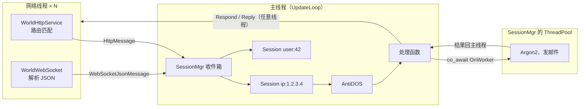

# 29 · 服务端核心：SessionMgr、AntiDOS、UpdateLoop 与 HTTP/WebSocket 接入

## 1. 是什么

网络线程只负责收发和解析，所有逻辑在**主线程**上按"帧"执行，所以逻辑代码不需要加锁。这套东西是 `rooftree-server` 库（`src/server/shared`），不和某个游戏绑在一起，HTTP、WebSocket 和以后的游戏连接都走同一条路：



blog 和以后的游戏**共用这份代码，也跑在同一个进程、同一个主循环里**（2026-10-29 作者的决定，原来打算各自一个进程，见 3.1.1）。框架本身不要求这样：`apps/arena` 就是单独的进程，有自己的 `World` 主循环，只用到这个库的包（[32](32-packets.md)），不走 `SessionMgr`。KCP（[33](33-kcp.md)）目前也只接在 arena 上，还没有进这条路。

## 2. 核心组成

| 类 | 作用 | 位置 |
|---|---|---|
| `Message` / `MessageType` | 网络线程交给主线程的一条消息；类型相当于 opcode，按名字注册 | [world/ServerMessage.h](../src/server/shared/world/ServerMessage.h) |
| `Session` | 一个客户端在主线程上的对象：消息队列、数据库回调、worker 任务 | [world/ServerSession.h](../src/server/shared/world/ServerSession.h) |
| `SessionMgr` | 收件箱、按 key 分发、每会话/每帧上限、轮转、移除空闲会话 | [world/SessionMgr.h](../src/server/shared/world/SessionMgr.h) |
| `AntiDosSettings` / `AntiDosTable` / `AntiDosCounter` | 按消息类型"N 秒内最多 M 次"，策略 Log/Reject/Kick | [world/AntiDos.h](../src/server/shared/world/AntiDos.h) |
| `UpdateLoop` / `FreezeDetector` | 最短帧间隔的主循环、卡死检测、帧耗时统计 | [world/UpdateLoop.h](../src/server/shared/world/UpdateLoop.h) |
| `SessionClassSettings` | 会话类别（游戏、网页）各自的预算和上限，见 3.1.1 | [world/SessionMgr.h](../src/server/shared/world/SessionMgr.h) |
| `FixedTicker` | 固定步长的世界 tick，落后时有限地补，见 3.1.2 | [world/FixedTicker.h](../src/server/shared/world/FixedTicker.h) |
| `WorldHttpService` / `WorldHttpRequest` | HTTP 请求变成消息，在会话里处理，任意线程 `Respond()` | [http/WorldHttpService.h](../src/server/shared/http/WorldHttpService.h) |
| `JsonHttp.h` | JSON 响应、统一的错误格式、按 Boost.Describe 解析请求体 | [http/JsonHttp.h](../src/server/shared/http/JsonHttp.h) |
| `WebSocketRouter` / `WorldWebSocket` | `{"type": ...}` JSON 消息按类型交给会话 | [websocket/WorldWebSocket.h](../src/server/shared/websocket/WorldWebSocket.h) |
| `SecurityUtils.h` | 随机 token、SHA-256、常量时间比较、base32/base64/base64url、Origin/CSRF 检查、otpauth 链接 | [security/SecurityUtils.h](../src/server/shared/security/SecurityUtils.h) |
| `Captcha.h` | 图形验证码：`GenerateCaptcha` 自己画字（折线字形，每个字单独旋转、错切、缩放，整体波浪扭曲，加干扰线和噪点），编码成灰度 PNG，不依赖字体和图像库；`CaptchaStore` 在主线程上保存发出去的验证码，检查一次就作废，答对答错都一样 | [security/Captcha.h](../src/server/shared/security/Captcha.h) |
| `RateLimiter<Key>` | 按任意 key 的滑动窗口限流（按账号、按邮箱） | [util/RateLimiter.h](../src/server/shared/util/RateLimiter.h) |
| `HttpFetch` | libcurl 发出去的 HTTP(S) 请求（比如找 OAuth 服务商换 token、取用户信息），阻塞，放在 worker 上用；只允许 http/https，不跟随跳转，响应体超过 1 MiB 算失败；`FormUrlEncode` 拼表单和查询串 | [http/HttpClient.h](../src/server/shared/http/HttpClient.h) |
| `Mailer` | libcurl SMTP，阻塞，放在 worker 上用；`MailMessage::Headers` 可以加 `List-Unsubscribe` 之类的头（检查换行，防注入） | [mail/Mailer.h](../src/server/shared/mail/Mailer.h) |
| `StaticSite` | 整个站点读进内存，在网络线程上回复，见 [30](30-static-files-and-tls.md) | [http/StaticSite.h](../src/server/shared/http/StaticSite.h) |
| `CommandTable` / `ConsoleSession` | 控制台，见 [31](31-console.md) | [console/](../src/server/shared/console/Console.h) |
| `Packet` / `FlatJsonSchema` | opcode + FlatBuffers 的包和 JSON 转换，见 [32](32-packets.md) | [packet/Packet.h](../src/server/shared/packet/Packet.h) |

## 3. 关键实现

### 3.1 一帧做什么

`SessionMgr::Update(diff)`（[SessionMgr.cpp](../src/server/shared/world/SessionMgr.cpp)）：

1. **worker 完成的任务**：`OnWorker` 的结果在这里交回主线程，等它的协程接着执行。
2. **收件箱 → 会话**：网络线程用无锁的 `MPSCQueue` 投递，主线程一次取完，按 `GetSessionKey()` 找会话，没有就调用 `CreateSession()` 新建。
3. **更新每个会话**：先执行它的数据库回调和 `Update()`，再最多处理 `MaxMessagesPerSessionPerUpdate`（默认 100）条消息，每条先过 AntiDOS，处理不完的留到下一帧。会话正在进行的后台工作（`RunOnWorker` 和查询回调）达到 `MaxPendingWorkPerSession`（默认 4，0 不限）时，它剩下的消息也等下一帧：否则一个会话排队的几十个慢请求会占住所有工作线程，别的会话的查询排在它们后面。博客和以后的游戏服共用这个值（2026-10-29 作者的决定，原来是 3）。代价是公平性：一个会话一帧能占 100 条，HTTP 会话实际受 `MaxQueuedMessagesPerSession`（64）限制。压测时一个地址狂刷不限流的读请求，其他读者的吞吐从 3 条时的 -30% 变成 -71%；有 AntiDOS 限制的消息超限后回 429 很便宜，但一个地址每秒能被拒绝 3 万次，其他读者的吞吐少了约 20%。
4. **移除会话**：已关闭的，或者空闲超过 `SessionIdleTimeout`（会话数到了 `MaxSessions` 的四分之三以后改用 `SessionIdleTimeoutWhenBusy`，默认 10 秒）、没有排队消息、没有未完成的回调、AntiDOS 窗口已经清空、`CanBeRemoved()` 同意的。一帧里要移除多少个都只扫一遍数组：一批新地址的会话往往在同一帧一起过期，逐个 `erase` 是 O(N²)，几十万个会话能让一帧卡几十秒。

### 3.1.1 会话类别（游戏和网页在同一帧里）

只服务游戏客户端的世界线程没有这个问题。这里同一个进程、同一个主循环同时处理游戏和网页（2026-10-29 作者的决定），两者的要求不一样：游戏的包多而小，每个玩家一个会话，按账号计；网页的请求突发、匿名，一个地址一个会话，会被刷。所以会话分**类别**：

- 消息类型注册时带上类别（`MessageTypeRegistry::Register(name, "game")`，或 `WebSocketRouter::SetSessionClass("game")` 之后注册的路由），会话的类别由它的第一条消息决定。`""` 是默认类别，就是 `SessionMgrSettings` 自己的那些字段，博客的 HTTP 和 `/ws` 都在里面。
- 每个类别有自己的 `SessionClassSettings`：`Priority`、每帧预算 `MaxMessagesPerUpdate`、每会话每帧 `MaxMessagesPerSessionPerUpdate`、队列、后台工作上限、会话数、空闲超时、封禁范围 `Block`。配置里 `Sessions.Classes.<名字>` 只写和默认类别不同的。
- 每帧按 `Priority` 从小到大处理各类别，**每个类别只用自己的预算**：网页再忙，也只是把网页的预算用完，游戏的那一份一条不少；每个类别各自轮转，各自记住下次从哪个会话开始。
- `Block: Address` 封地址（匿名的网页客户端），`Block: Session` 只封这个会话的 key（玩家的账号）：网吧里一个人开外挂刷包，同一个 IP 的其他玩家照常玩。

### 3.1.2 游戏 tick 和消息分开

只有游戏时，世界可以每帧都更新，客户端只等这一种节拍。游戏和网页在同一个循环里时，节拍要分开：循环照样每 `MinUpdateDiff`（2 ms）跑一轮处理消息，游戏的世界每 `WorldTick`（50 ms）才更新一次（`FixedTicker`，博客里是 `BlogWorld::AddWorldTick`，目前没有人注册 tick，留给以后的游戏）。网页请求不用等一个 tick，游戏的世界也有稳定的步长。世界落后时一次最多补 `WorldTickMaxCatchUp` 个 tick，其余丢掉并计数（日志 `server.world` 每分钟一行：tick 数、平均和最长耗时、丢了几个）：越补越慢的循环比落后更糟。

### 3.1.3 出错只影响出错的那一个

同一个进程服务游戏和网页，任何一处异常都不能把整个服务器带走。抛出异常时只丢掉出错的那一个，记一行 ERROR：

| 哪里抛出 | 结果 |
|---|---|
| 一条消息的 `Process` | 只丢这条消息（HTTP 请求回 500），会话的下一条照常处理 |
| 会话的 `Update` 或数据库回调 | 关闭这个会话 |
| `OnWorker` 的 work | 异常从 `co_await` 抛出，会话的未完成工作照常减一 |
| 协程没接住的异常 | 记一行 ERROR，协程结束，会话照常（HTTP 请求回 500） |
| 一个世界 tick（博客的 `AddWorldTick`） | 其他 tick 和下一个 tick 照常 |
| 整个 update（`UpdateLoop::Run`） | 下一个 update 照常 |

前提仍然是主线程不阻塞：慢的事（查询、文件、哈希、zip、邮件）都在工作线程上，博客已经逐个核对过（2026-10-29）。卡死（而不是异常）由 `MaxCoreStuckTime` 处理，它会让整个进程退出、重启。

### 3.1.4 重启要先通知，能重载的都重载

C++ 换代码只能重启进程，游戏的玩家和网页的读者都会断开，所以没有真正的"热重载代码"。能做的两件事：

- **能在运行中改的都在运行中改**：`SIGHUP`（或控制台 `server reload`）重读配置，会话类别、AntiDOS、帧间隔、世界 tick、统计间隔、停止前的等待时间都在下一帧生效，证书和预渲染的页面也重新读。地址、端口、线程数、连接层的限制只在启动时读。
- **必须重启时先通知**（"Server shutdown in 5:00"）：第一个 `SIGTERM`（`docker stop`、`systemctl stop`、部署）不立刻停，而是 `ShutdownDelay` 秒后停，期间告诉每个页面（和以后的玩家）还有多久，剩 60、30、10、5 秒时再说一次；第二个 `SIGTERM` 立刻停。控制台的 `server restart <时间>` 走同一条路，`cancel` 时也会通知。信号只在网络线程上计数，安排停止在主循环里做，`UpdateLoop` 不需要锁。

### 3.1.5 实测：游戏和网页同一帧，网页被刷

`./benchmarks "[gameweb]"`（`benchmarks/bench_GameAndWeb.cpp`）按真实时间模拟：1000 个玩家每人每秒 10 个包（每个 2 µs），世界 tick 每次 10 ms；网页每秒 500 个请求、200 个地址，每个在工作线程上查库 300 µs；再加刷子：8 个地址狂刷要查库的请求，或 64 个地址狂刷从内存回答的请求（主线程 5 µs 一个），都是不限流、不会被封的最坏情况。2026-10-29，32 核开发机，单位 ms：

| 方式 | 刷子 | 游戏 p50/p99 | 网页 p50/p99 | tick 间隔 p99 |
|---|---|---|---|---|
| 每帧都更新世界，一帧 50 ms | 无 | 25.7 / 49.7 | 75.2 / 99.7 | 50.5 |
| 同上 | 内存 | 72.3 / 150.7 | 117.6 / 197.2 | 55.2 |
| tick 分开，全部一个类别 | 无 | 1.4 / 9.6 | 3.5 / 11.9 | 51.6 |
| 同上 | 内存 | 18.3 / 38.2 | 26.1 / 48.4 | 50.7 |
| tick 分开，游戏单独类别、先处理，网页每帧 2000 | 内存 | 6.9 / 20.5 | 27.8 / 48.1 | 53.3 |
| 同上，网页每帧 500（现在的配置） | 无 | 1.2 / 9.6 | 3.3 / 11.8 | 51.6 |
| 同上 | 查库 | 1.4 / 9.7 | 5.7 / 14.3 | 51.3 |
| 同上 | 内存 | 1.8 / 12.6 | 19.9 / 36.8 | 50.8 |

- tick 分开让网页不再等 tick：p50 从 75 ms 到 3.5 ms。游戏的 p99 约 10 ms，是正好碰上一次 10 ms 的世界更新。
- 查库的刷子卡在工作线程和每会话的未完成工作上限（4），主线程不受影响，类别分不分都一样。
- 只占主线程的刷子会把一帧拉长：每帧放进来的网页消息越多，一帧越长，玩家等得越久。游戏先处理只能保证它在一帧里排第一，**网页的每帧预算要小**：从 2000 降到 500，游戏的延迟回到和没人刷时一样，刷子的吞吐（每秒约 14.7 万条）也没变少。

### 3.2 每帧总预算与公平

`MaxMessagesPerUpdate` 限制一帧里所有会话加起来处理多少条（0 表示不限）。预算用完时记下下一个会话的位置，**下一帧从它开始**。这样服务器忙的时候，排在后面的会话也不会一直等：

```
预算 3，每会话 2，会话 a、b、c 各有 2 条
第 1 帧：a0 a1 b0      ← 预算在 b 用完
第 2 帧：c0 c1 b1      ← 从 c 开始，绕回 a（空）、b
```

（测试 "SessionMgr's per-update budget serves sessions in turn"。）

### 3.3 有界队列

三层上限，超出就立刻拒绝（`RejectReason::Overloaded`，HTTP 回 503），而不是无限堆积内存：

- 收件箱 `MaxPendingMessages`（默认 10 万），在网络线程上检查；
- 每个会话 `MaxQueuedMessagesPerSession`（默认 64），分发时检查；
- 会话总数 `MaxSessions`（默认 10 万，0 不限），新 key 的第一条消息在分发时检查。每帧都要遍历所有会话，会话数没有上限的话，换着地址发请求就能让每一帧越来越慢。但满了以后新地址一律 503：每个地址只来一次、然后空闲 5 分钟才释放，10 万个地址（两个 IPv6 /48）就能让新读者在这 5 分钟里都进不来。所以到了四分之三，空闲超时缩短到 `SessionIdleTimeoutWhenBusy`，只来过一次的会话很快让出位置；还在 AntiDOS 窗口里的会话照样留着，换地址重新计数的老办法仍然行不通。

HTTP 连接本身同时只处理一个请求（[28 · 3.3](28-http-routing.md#33-一个连接同时只处理一个请求)），所以一个连接最多占一个位置。

### 3.4 AntiDOS

阈值来自配置，按消息类型名，窗口是滑动的（不是按秒清零的固定窗口）：

```yaml
AntiDos:
  Policy: Reject        # Log | Reject | Kick
  KickDuration: 60      # 秒，Kick 之后这个 key 被拒绝多久
  Exempt: ["127.0.0.1", "::1"]   # 这些地址来的消息不计数，也不会被封
  BlockAfter: { Window: 10, Rejections: 1000 }   # 10 秒内被拒 1000 次，封地址 KickDuration
  Limits:
    auth.login:     { Window: 60, MaxCount: 5 }
    comment.create: { Window: 60, MaxCount: 3 }
```

- **滑动窗口**：记录窗口内放行的时间戳，最多 `MaxCount` 个。固定窗口在边界前后各发 `MaxCount` 次就能翻倍，滑动窗口不会。
- **策略**：`Log` 只记日志照常处理（上线前先用它找合适的阈值），`Reject` 拒绝这条（HTTP 回 429 + `Retry-After`），`Kick` 拒绝并关闭会话、在 `KickDuration` 内拒绝这个 key 的所有消息。每次超限都会调用会话的 `OnAntiDosViolation()`，应用可以在这里封号。
- **豁免地址**（`Exempt`，默认没有）：从这些地址来的消息不计数，给本机自己的客户端用，比如预渲染通过 API 读每一篇文章，几百篇就会超过读者的限制。按消息的客户端地址判断（双栈监听收到的 `::ffff:127.0.0.1` 当作 `127.0.0.1`）；前面有反向代理时客户端地址是 `X-Forwarded-For` 里的那个，不是代理的，所以只有本机直接来的请求才算。
- **封地址**（`BlockAfter`，默认不封）：一个会话在 `Window` 秒内被拒绝（超限或队列满）`Rejections` 次，就把它的客户端地址放进 `SessionMgr` 的 `AddressBlocklist`，封 `KickDuration`，会话关闭。之后网络线程直接丢掉这个地址的东西，主线程看不到：新连接在 `SocketMgr` 接受时就关掉（不握手），已经开着的连接在下一个请求时关掉、不回复，WebSocket 消息进队列时关掉连接。经过受信任代理来的，只封代理转发的那个客户端，回 429，代理的连接留着。IPv6 按 /64 封，封禁表只放在内存里。回 429 很便宜，但不是没有成本，每帧每会话 100 条时，一个不理会 429 的客户端每秒能送进几万个请求，让 2 核的服务器把时间都花在拒绝上。偶尔超限的正常读者只会收到 429，离 1000 次很远。
- **应用的默认值**：`AntiDosSettings::FromConfig(config, path, defaults)` 以应用给的设置为底，配置里写了的键覆盖它；`Limits` 按类型合并，配置没提到的类型保留默认限制，`MaxCount: 0` 取消一条。这样配置文件没跟上新版本时，新加的消息类型也有限制。
- 会话被移除前要等 AntiDOS 窗口清空，否则等空闲超时、换个新会话就能重新计数。
- **日志按"一轮"记，不按条记**：一个会话某种类型第一次超限写一行 WARN，之后只计数；还在超限就每 `AntiDosLogInterval`（1 分钟）补一行这段时间被拒了多少，整整一个窗口没再超限（或会话被移除）时写一行收尾。被拒的请求来得多快，逐条的日志就写得多快：单个地址 15 秒能写上万行，交给 journald 会撞上它的速率限制，把同一段时间里真正的错误一起丢掉。另外每分钟一行汇总：这段时间各种原因（超限、被踢、队列或会话数满）拒绝了多少、多少会话超限、会话数，只在有拒绝时才写。以前会话满了回 503 一行日志都没有。
- `LoadSettings` 只记下限制，**下一次 `Update()` 才按名字对应到消息类型**。应用通常先读配置、后注册路由（路由注册时才有类型），如果在 `LoadSettings` 里就对应，所有限制都会被当成未知类型忽略，直到第一次重新加载配置。名字写错的限制仍然会在日志里警告。

### 3.5 HTTP：网络线程匹配，主线程处理，任意线程响应

`WorldHttpService::Route(method, path, type, &MySession::Handler)` 在 `DispatcherService` 上注册一个网络线程处理函数：

1. 算出客户端地址和会话 key，把请求包成 `WorldHttpRequest`，再包成 `HttpMessage` 投进 `SessionMgr`，返回 `Async`；连接暂停读取。
2. 主线程上，`HttpMessage::Process` 调用 `MySession::Handler(request)`。
3. 处理函数（或者它发起的数据库回调、worker 任务）调用 `request->Respond()` / `RespondJson()` / `RespondError()`，大文件用 `RespondStream()` 边读边发（[19 · 3.6](19-http.md)）。响应被 `post` 到连接所属的网络线程写出，所以**哪个线程调用都可以**。
4. 如果一个请求直到最后一个引用释放都没有响应，析构函数回 500，并记一条 error 日志。

404 和 405 仍然在网络线程上直接回，不进主线程。

**会话 key 是客户端地址**（`ip:1.2.3.4`；IPv6 按 /64，`ip:2001:db8:1:2::/64`，因为一个用户通常分到整个 /64，可以随意换地址），不是 Cookie。网络线程分不清真假 Cookie，如果按 Cookie 分会话，每次带一个随便编的 Cookie 就能得到一个全新的会话，每会话上限和 AntiDOS 都形同虚设。按账号的限制（比如每个用户的评论频率）由应用在主线程上确认身份以后用 `RateLimiter` 做。需要别的 key 时覆盖 `GetSessionKey()`。

**反向代理**：`WorldHttpSettings::TrustedProxies` 里的地址才会被相信 `X-Forwarded-For`；从右往左跳过受信任的代理，第一个不受信任的地址就是客户端。

### 3.6 WebSocket

`WorldWebSocket` 是一个 `WebSocket::Connection`（[27](27-websocket.md)），自己没有 socket 和端口：`WorldHttpService::WebSocketRoute(path, factory)` 在 HTTP 端口上接受握手，由工厂函数创建它，之后由那条 HTTP 连接运行（[WorldHttpService.cpp:221](../src/server/shared/http/WorldHttpService.cpp#L221)）。所以 WebSocket 和 API 共用端口和 TLS，`wss://` 不用另外配置。

它在网络线程上把 `{"type": "chat", "text": "hi"}` 解析成类型和消息体，在 `WebSocketRouter` 里查类型（注册成 `ws.chat`，AntiDOS 用这个名字），再投给连接所属会话。会话 key 在创建时给定（比如从握手地址里的登录票据得到 `user:42`）。

- 未知类型回 `{"type": "error", "code": "unknown_type"}`；
- 不是带字符串 `type` 的 JSON 对象，直接以 1007 关闭连接；
- 被拒绝的消息回 `{"type": "error", "code": "rate_limited", "for": "chat"}`。

工厂函数拿到的 `clientAddress` 和 HTTP 请求一样认 `X-Forwarded-For`。匿名的 WebSocket 想和同一地址的 HTTP 请求共用一个会话时，用 `WorldHttpService::AddressSessionKey(clientAddress)` 作为 key。blog 的在线人数就是这样做的（[BlogWebSocket.cpp:32](../apps/blog/server/BlogWebSocket.cpp#L32)）：先检查 `Origin`，不是自己的页面就回 403。

`WorldHttpService::GetRequestCount()` 是整个进程所有 HTTP 服务收到的请求数（含跳转和静态文件），任意线程可读；blog 的「看云」页用它算每分钟请求数（[ServerStatus.cpp](../apps/blog/server/ServerStatus.cpp)）。

`WorldHttpSettings::WebSocketIdleTimeout` 和 `WebSocketMaxWriteQueueSize` 是升级后连接的空闲超时和写队列上限。

### 3.7 不阻塞主线程

| 要做的事 | 做法 |
|---|---|
| 数据库查询 | `AsyncQuery(...)` + `session.AddQueryCallback(...)`，回调在这个会话后面某一帧执行 |
| CPU 密集（Argon2）、阻塞 IO（发邮件）、几个前后依赖的查询 | 协程：`co_await session.OnWorker(work)`，`work()` 在 `SessionMgr` 的线程池上执行，结果回到主线程 |

两者在完成之前都会**让会话一直保留**，所以回调和协程里可以放心使用会话。

`session.Spawn(task)` 启动一个 `Rooftree::Task<void>`（[sched/Task.h](../src/common/sched/Task.h)），立刻执行到第一个需要等待的 `co_await`。`co_await session.OnWorker(work)` 在工作线程上跑 `work()`，之后回到主线程接着执行，还是在 `SessionMgr` 处理完成队列的那一步：

```cpp
Rooftree::Task<void> GetPage(Session& session, ApiRequest request)
{
    Optional<uint32> id = ReadId(request);
    if (!id)
        co_return RespondNotFound(request);

    Optional<Page> page = co_await session.OnWorker([id = *id] { return LoadFromDatabase(id); });
    if (!page)
        co_return RespondNotFound(request);
    request->Respond(Serialize(*page));
}
```

`co_return f();` 在 `f()` 返回 `void` 时也成立，所以提前返回的写法和普通函数一样。以前这里是 `RunOnWorker(work, done)`：结果交给 `done` 回调，几步依赖的工作就是回调套回调。现在框架里只剩协程这一种写法：

- **在哪里启动**：博客的每个 API 操作（`ApiOp`，[ApiCall.h](../apps/blog/server/ApiCall.h)）都是协程，路由、数据包、控制台调用它时都用 `Spawn`。`WorldHttpService::Route` 也接受返回 `Rooftree::Task<void>` 的会话成员函数，由它来 `Spawn`。控制台命令用 `CommandHandler::Spawn(task)`：协程运行期间它一直持有这个 handler，所以下一条命令和提示符都会等协程结束。
- **等一个回调**：`co_await Rooftree::WhenCalled<Args...>(initiate)` 把一个主线程上的回调接口（比如博客的 `RequireUser`，它可能立刻回调、稍后回调，也可能直接回答 401、根本不回调）变成可以等待的东西。回调被调用时 `co_await` 得到它的参数；所有副本都没被调用就销毁了，得到的是空值。协程在等待时被销毁的话，之后再调用回调什么也不做。博客的 `RequireUserAsync`、`RequireDrive` 就是这样写的。
- 它算作未完成的工作，`MaxPendingWorkPerSession` 对它同样有效，等待期间会话不会被移除。
- `work` 抛出的异常从 `co_await` 抛出；协程自己没接住的异常记一行 ERROR，会话继续运行，这条 HTTP 请求由 `WorldHttpRequest` 的析构函数回 500。
- 会话被移除或服务器停止时，还在等待的协程直接销毁，不再往下执行。
- **参数按值传**：引用和 `string_view` 参数在第一次 `co_await` 后就可能失效，除非它指向的东西活得比协程长（会话本身、`CommandHandler::Spawn` 下的 handler）。本身就是协程的 lambda，捕获的变量也一样（测试里踩过这个坑，ASan 能抓到）。
- **每个 `co_await` 之后都要重新确认状态**：主线程仍然不用加锁，但等待期间别的消息可能已经改了状态，比如玩家已经下线、缓存里的一项已经换掉。指向缓存的引用不要跨过 `co_await` 使用，需要的话先拷贝一份。
- **不要用在游戏的每个包或每个 tick 上**：协程要分配栈帧。

代价（`./benchmarks "A worker round trip*"`）：改成协程之前，回调版一次工作线程往返 267 ns，协程版 280 ns。`[gameweb]` 里网页查询用协程时，游戏和网页的延迟和回调版没有差别。

### 3.8 主循环与卡死检测

`UpdateLoop::Run(update)`：距离上一帧不到 `MinUpdateDiff` 就睡到够为止，否则立刻用真实经过的时间调用 `update(diff)`。空闲时省 CPU，忙的时候一帧接一帧，`diff` 变大，没有固定帧率。每 `StatsInterval`（默认 60 秒）在 `server.world` 上记一条帧数、平均和最大帧耗时。

`FreezeDetector` 在 io_context 上每秒检查一次循环计数器，超过 `MaxCoreStuckTime` 没有变化就记 fatal 日志并 `ABORT`，让 systemd 重启一个"进程还在但已经卡死"的服务器。

### 3.9 每帧预算怎么定

[benchmarks/bench_Server.cpp](../benchmarks/bench_Server.cpp) 测框架本身的开销，处理函数什么都不做（i9-13980HX，GCC 16，RelWithDebInfo）：

| 场景 | 每帧 1000 条消息 | 空帧（没有消息） |
|---|---|---|
| 1 个会话 | 35 µs | 0.03 µs |
| 100 个会话 | 44 µs | 0.4 µs |
| 1000 个会话 | 50–60 µs | 4.8 µs |

也就是每条消息 35–60 ns，每个空闲会话每帧约 5 ns。框架开销可以忽略，**预算由处理函数决定**：`MaxMessagesPerUpdate ≈ 一帧允许花在消息上的时间 ÷ 典型处理函数的耗时`。处理函数只是发起一个异步查询的话，每条在几微秒以内，5 ms 一帧可以处理上千条。

## 4. 线程与安全

| 函数 | 线程 |
|---|---|
| `MessageTypeRegistry::Register`、`WorldHttpService::Route`、`WebSocketRouter::Add` | 启动时，网络开始之前 |
| `SessionMgr::Enqueue`、`WorldHttpRequest::Respond*`、`WebSocketJsonMessage::Reply`、`WorldWebSocket::SendJson` | 任意线程 |
| `SessionMgr::Update`、`LoadSettings`、`FindSession`，`Session` 的所有成员（`OnWorker` 的 `work` 除外） | 主线程 |
| `UpdateLoop::Stop`、`IsStopped`、`GetLoopCounter` | 任意线程 |
| `Mailer::Send` | 任意线程，阻塞，放在 worker 上 |

**关闭顺序**：先停网络（不再有新消息），再停主循环，最后 `SessionMgr::Stop()`（等 worker 完成，拒绝剩下的消息，移除所有会话）。

## 5. 设计取舍

`AsyncAcceptor::Close()` 会等被取消的 accept 完成，见 [15 · 设计取舍](15-async-acceptor.md#5-设计取舍)。

## 6. 常见的坑

- **处理函数里不要做同步查询**：会阻塞整个主线程，所有会话一起卡住。这要靠自觉和代码审查。
- **`Respond()` 之后不要再改响应**：响应已经交给网络线程了。
- **测试里先声明被消息引用的对象，再声明 `SessionMgr`**：`SessionMgr` 析构时会拒绝剩下的消息，消息的 `Reject()` 不能访问已经析构的对象（ASan 在 test_ServerCore.cpp 里抓到过一次）。
- **`OnWorker` 的 `work` 在别的线程上执行**：只能使用它自己捕获的数据，不要访问会话。
- **NAT 后面的用户共用一个 IP 会话**：每会话每帧 100 条（排队最多 64 条）、2 ms 一帧（blog 的默认），一个 IP 每秒能送进几万条，正常使用远远够，挡住滥用要靠 AntiDOS；但 AntiDOS 的按 IP 限制（比如登录）是大家一起算的，阈值别定得太低。

## 7. 测试与示例

- [tests/test_ServerCore.cpp](../tests/test_ServerCore.cpp)：协程（`[coroutine]`）、每会话上限、预算轮转、会话类别、`FixedTicker`、异常隔离、`MaxPendingWorkPerSession`、AntiDOS 三种策略、封地址和配置读取、有界队列、暂停/关闭/空闲移除、`WhenCalled`、主循环、`RateLimiter`、编码和 CSRF、邮件格式。
- [tests/test_ServerNetwork.cpp](../tests/test_ServerNetwork.cpp)：`WorldHttpService` 回环（路径参数、`X-Forwarded-For`、JSON 错误、忘记响应回 500、worker、429、被封的客户端、流式响应、8 个客户端并发）；`WorldWebSocket` 在 HTTP 端口上用 Beast 客户端（路由、未知类型、限流、1007、拒绝握手、同一端口照样回答 HTTP），以及 TLS 上的 `wss://`；`Mailer` 对一个简易 SMTP 服务器真实发信。所有处理函数都检查自己运行在主线程上。
- [apps/blog](../apps/blog/PLAN.md)：完整的应用。

## 8. 思考题与练习

1. 如果每帧都从第 0 个会话开始处理，预算紧张时会发生什么？
2. 为什么 AntiDOS 计数放在会话里，而不是在网络线程上按连接计数？
3. `Kick` 封禁的是会话 key。HTTP 会话 key 是 IP，这对 NAT 后面的用户意味着什么？要按账号封禁，应该在哪里做？
