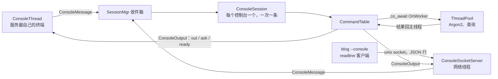

# 31 · 控制台：命令表、CliThread 与 RA

## 1. 是什么

游戏服务器常在自己的终端上显示一个提示符，管理员在这里输入 `account create`、`account set password`、`server shutdown` 这类命令：终端线程读一行，放进队列，主线程在更新时按命令表找到处理函数并执行，结束后再打印一次提示符。

Rooftree 的控制台就是这样，队列是会话核心（[29](29-server-core.md)）：**每个控制台都是一个客户端**。



因此命令和 HTTP 请求的写法完全一样：在主线程检查参数，用 `CommandHandler::Spawn` 启动的协程（`co_await OnWorker`）或 `AddQueryCallback` 去做阻塞的事情，结果在主线程打印。

## 2. 核心组成

| 类 | 作用 | 位置 |
|---|---|---|
| `Command` / `CommandTable` | 命令树；单词可以缩写成在同级中唯一的前缀；自带 `help`；`Complete()` 给 Tab 补全用 | [console/ConsoleCommand.h](../src/server/shared/console/ConsoleCommand.h) |
| `CommandHandler` | 命令的输出和提问；`shared_ptr`，最后一个引用释放时命令才算结束 | 同上 |
| `ConsoleOutput` | 一个控制台的输出去哪里：打印、提问、就绪（提示符） | [console/Console.h](../src/server/shared/console/Console.h) |
| `ConsoleMessage` / `ConsoleSession` | 一行就是一条消息；会话在命令（包括它的异步任务和提问）结束前不处理下一条命令 | 同上 |
| `ConsoleThread` | 服务器自己的终端（stdin 是终端时才启动） | 同上 |
| `ConsoleSocketServer` / `RunConsoleClient` | unix socket 上的控制台和它的 readline 客户端 | [console/ConsoleSocket.h](../src/server/shared/console/ConsoleSocket.h) |
| `UpdateLoop::StopAfter` | 定时停止，带退出码 | [world/UpdateLoop.h](../src/server/shared/world/UpdateLoop.h) |

## 3. 命令表

```cpp
CommandTable commands(
{
    { .Name = "account", .Subcommands =
        {
            { .Name = "set", .Subcommands =
                {
                    { .Name = "password", .Help = "Syntax: account set password <account>",
                      .Handler = &HandleAccountSetPassword },
                } },
        } },
});
```

- `acc set pass` 和 `account set password` 等价；一个单词能匹配多个命令时，列出候选，不执行
- 有子命令的组只输入组名时列出子命令；一个命令可以既有处理函数又有子命令，下一个单词不是子命令时就当作参数
- 处理函数拿到的是剩下的整行，用 `SplitCommandArgs` 按空格拆分，双引号里的空格保留。返回 `false` 表示参数不对：如果它自己没输出过什么，就打印 `Help`

异步命令要用 `handler.shared_from_this()` 把 handler 保留到任务结束，这样提示符才会在结果之后出现，下一条命令也会等它完成。为此 `SessionMgr` 在**每条消息之前**都会问一次 `CanProcessMessages()`，所以一条消息可以挡住它后面的消息。

**提问**：`handler.Ask(prompt, secret, answer)` 让这个控制台的下一行作为回答，交给 `answer`，而不是当成命令执行。`secret` 表示输入不回显。改密码就是这样问两次，所以密码不会出现在命令行、终端回显和 readline 历史里：

```cpp
handler.Ask("New password: ", true, [account](CommandHandler& handler, std::string password)
{
    handler.Ask("Again: ", true, [account, password](CommandHandler& handler, std::string again) { ... });
});
```

客户端断开时，`Kind::Closed` 消息会关闭它的会话，没回答的问题连同 handler 一起丢掉。

## 4. 两种控制台

**服务器自己的终端**（`ConsoleThread`）：在前台运行服务器时用：

- 没有 readline，只用终端自己的行编辑。为了 `Stop()` 能在 100 ms 内退出，用 `poll` 加超时代替阻塞的 `read`
- 只在 stdin 是终端时启动。读到输入结束（Ctrl+D）只结束控制台，不关闭服务器
- 输出和服务器日志写在同一个终端上；在 docker 或 systemd 下，终端里的内容会进 `docker logs` 或 journald，所以那两种环境下用下面的 socket

**unix socket**（`ConsoleSocketServer` + `RunConsoleClient`）：远程控制台，但不开端口、不用密码。

- 能打开 socket 文件的人就能进：文件建成 0600，另外用 `SO_PEERCRED` 检查对方是不是服务器的用户或 root
- 每个连接是一个独立的控制台（会话 key 是 `<console:N>`），最多 8 个
- 协议是一行一个 JSON 对象。客户端只发 `{"line": "..."}`，可以是命令也可以是回答。服务器发 `{"out": "..."}`（打印）、`{"ask": "Password: ", "secret": true}`（提问）、`{"ready": "RT> "}`（等下一条命令）
- 客户端用 readline：有历史记录，用 `CommandTable::Complete` 做 Tab 补全（客户端用的是同一份命令表）；回答 secret 问题时关掉回显。Ctrl+C 和 Ctrl+D 只结束客户端，不影响服务器。没有终端时从 stdin 逐行读命令，可以在脚本里用
- 输入和输出只在客户端和服务器之间传递，不进服务器日志
- 服务器这边在网络线程上运行三个协程：接受连接、每个连接读一行、写出排队的消息（`AcceptLoop`、`ReadLoop`、`WriteLoop`）。读写协程按值持有连接，两个都结束后连接才释放

## 5. 不做的

- 类型化参数：命令不多，用 `SplitCommandArgs` 就够了
- RBAC 权限：能连上控制台的就是管理员
- SOAP

## 6. blog 的命令

[apps/blog/server/ConsoleCommands.h](../apps/blog/server/ConsoleCommands.h)：

```
account list / lookup account <text>
account set password <account>          问两次，不回显
account set 2fa <account> [off]         新的 TOTP 密钥，直接在终端显示二维码
account set username|email|name <account> <value>
account delete <account>                账号还有文章或上传文件时拒绝
ban account|ip <...> <time|perm> [reason]，unban account|ip，banlist account|ip
site show / site export                 站点资料，export 输出一行 JSON
site review on|off                      打开后，写作者发布文章要管理员先看
site import <json>                      整份替换，校验和后台「站点」页一样
site set <field> [zh|en] <text>         改一项，其余不动；多行文字和社交链接用 import
server info / server reload / server shutdown|restart <time>|cancel
post list|show|create|edit|publish|unpublish|decline|delete，post translation set|delete
post revisions <post> [<version>]，post save-version <post> [note]，post restore <post> <version>
post editors <post>，post editor add|remove <post> <account>，post owner <post> <account>
tag list|add|edit|delete
comment list|keep|hide|show
chat groups|messages|delete|clear|dissolve   广场和群聊的管理，不碰私聊
friend list|approve|reject|add|edit|delete（友链，不是读者之间的好友），project list|add|edit|delete
upload <file>                           上传图片，给出 /uploads/ 地址
account show|create|role|deny|allow|write|drive|kick|reset-mail
drive list                              有网盘的账号和用量
online / stats [days] / status
api routes [text]                       所有接口（方法、路径、AntiDOS 类型）
api get|post|put|patch|delete <path> [--as <account>] [-H "Name: value"] [--out <file>] [--form] [body]
```

### 后台的命令

[ConsoleAdmin.h](../apps/blog/server/ConsoleAdmin.h)。后台每个页面能做的事都有自己的命令，在服务器里直接执行，不经过 HTTP：每条 `/api/admin/...` 路由的处理逻辑抽成了一个 ApiOp（[ApiCall.h](../apps/blog/server/ApiCall.h)），它拿到的 ApiCall 长得和请求一样（JSON 正文、路径和查询参数、谁在调用），用 RespondJson/RespondError 回答。网页那边是处理函数先检查登录再调它，把回答发出去；控制台以管理员身份调同一个函数，把回答排成文字打印出来。所以校验、日志、重建网站、发邮件、通知打开着的页面都完全一样，出错时打印的就是接口的错误（「Nothing was saved」后面列出字段）。

`<post>` 可以是 slug 也可以是编号；`<account>` 是用户名或邮箱；`<file>` 是服务器上的路径（Docker 里是容器里的，用 `docker compose cp` 放进去）。新加后台功能时，同时加它的命令和测试（`tests/console-admin.test.mjs`）。

```
post create zsh-terminal zh "让 Windows 和 Linux 用同一个终端" /tmp/zsh.md
post translation set zsh-terminal en "One Terminal on Windows and Linux" /tmp/zsh.en.md
post edit zsh-terminal tags workflow,terminal
post publish zsh-terminal
```

### api：控制台命令做不了的

读者那一侧的事（注册登录、OAuth、两步验证的流程，以某个读者身份评论、点表情、申请友链、加好友、发聊天消息，网盘的分片上传、分享和 zip，订阅、验证码）没有单独的命令，用 `api`：

[ConsoleApi.h](../apps/blog/server/ConsoleApi.h)。`api` 在服务器上给自己的明文端口（127.0.0.1，不会被重定向到 https）发一个真正的 HTTP 请求：走同一个处理函数、同样的校验、AntiDOS 和日志。新加的路由不用改控制台就能用 `api` 调。

- 身份：默认是管理员，`--as <account>` 换成别的账号（用户名或邮箱），权限就是那个账号自己的。控制台为这一个请求建一个登录会话（User-Agent 是 `blog console`），请求完就删掉，不用密码和 TOTP：能连上控制台的本来就是管理员
- 正文：`{...}` 或 `[...]` 原样当 JSON；`@文件` 是文件的字节（Content-Type 按扩展名猜，`-H` 可以改）；其余是 httpie 那样的条目，拼成一个 JSON 对象：`key=文字`、`key:=JSON`、`key=@文件`（文件内容当字符串）、`key:=@文件`（文件内容当 JSON），`a.b=x` 是嵌套。条目里的双引号保留空格（`title="a b"`），单引号原样（`tags:='["a", "b"]'`）。`--form` 发 multipart：`key=文字`、`key@文件`
- 输出：状态行，JSON 缩进后打印；二进制或太大的用 `--out <文件>` 存下来
- 文件是服务器读、服务器写的，路径是服务器上的（Docker 里就是容器里的）
- 一次只跑一个 `api`：工作线程要等响应，而请求本身也要用工作线程

以某个读者的身份评论：

```
api post /api/comments --as alice postId:=12 body="写得好"
```

`<account>` 可以是用户名，也可以是邮箱。`server restart` 的退出码是 2，这样 systemd 的 `Restart=on-failure` 会把它重新拉起来；`shutdown` 的退出码是 0。用法见 [apps/blog/README.md](../apps/blog/README.md)。
